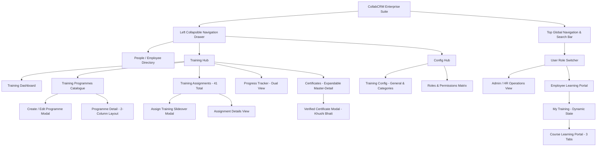
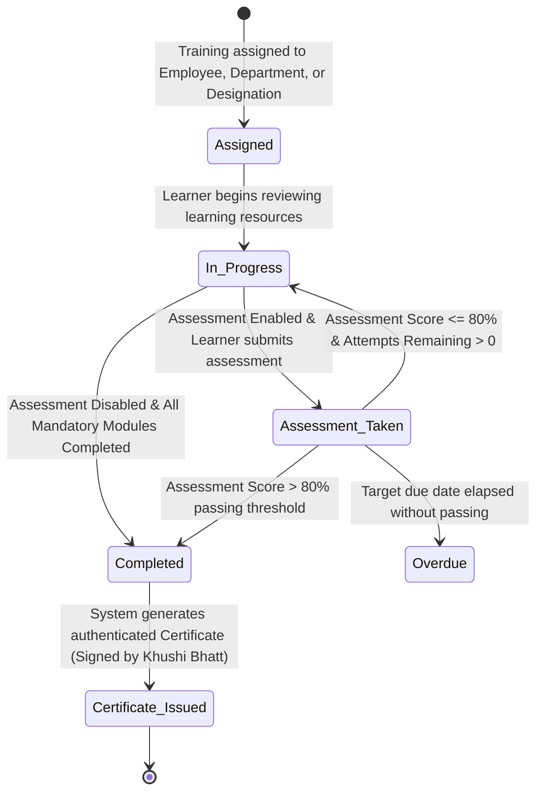

# CollabCRM People Training Module - Developer Flow & Field Specification

## Document Overview
This document specifies the exact developer architecture, screen flows, user roles, data schemas, validation rules, and dynamic interactions for the **CollabCRM People & Training Module**. Every field, allowed value, form control, and layout matches the live implementation prototype.

---

## SECTION 1: SYSTEM NAVIGATION & SCREEN FLOWS

### Flow 1: Top Navigation & Role Switching
- **Global Header**: Contains company branding (`CollabCRM People`), global search (`Search employees, programmes`), notifications bell, and the Active User Profile indicator (`Tanya Kapoor - Business Analyst • Employee` or `Ishdeep Anand - Admin • Management`).
- **Role Switching**: Clicking the user badge toggles between **Admin/HR View** and **Employee User Role View**. Switching to an Employee role redirects directly to the Employee Dashboard and personal learning workflows.

---

### Flow 2: Navigation Drawer Structure
The left collapsible sidebar provides access to:
1. **Employees** (`employees`): Complete employee directory with profile cards and Add Employee modal.
2. **Training Hub**:
   - **Dashboard** (`training-dashboard`): Real-time metrics (Active Learners, Total Assignments, Completion Rate, Average Score), urgent review queue, and performance analytics.
   - **Training Management** (`training-programmes`, breadcrumb: `Training Programmes`): Full course catalogue, status filters (All, Published, Draft), search, and `+ Create Programme` action.
   - **Assignments** (`training-assignments`): Central assignment register with **`ASSIGNED SCOPE`** column (Employee, Department, Designation), `41 Total` assignment count, and 5-page pagination (10 items/page).
   - **Progress** (`training-progress`): Dual-mode tracking (`1. Employee-wise Training Completion` vs `2. Departmental Compliance Audit`), 4 KPI cards (`ACTIVE LEARNERS`, `TOTAL ASSIGNMENTS`, `COMPLETED`, `AVG SCORE`), and CSV export.
   - **Certificates** (`certificates`): Expandable master-detail table matching Screenshot 3 format (`^ / v` toggle chevron, plain-text earned programmes, and right-aligned Actions column directly under `All Records`).
3. **Config Hub**:
   - **Training Config** (`config`): Tabbed settings for **General Settings** (5 module access permission toggles) and **Training Categories** (master category table + Add Category modal with duplicate validation).
   - **Roles & Permissions** (`roles`): 11-role RBAC table (`Sr. Business Analyst`, `Senior Recruiter`, `CEO`, `Project Manager`, `BDE`, `Admin/HR`, `Employee`, `Team leader`, `Management`, `Recruiter`, `BDM`), `+ Add Role` slideover modal, and interactive Role Permission Matrix.
*(Note: The legacy "Reports" drawer item has been removed.)*

---

### Flow 3: Training Management (Create / Edit Programme Flow)
- Access via `Training Programmes > + Create Programme` or `Edit Programme`.
- Features an **Auto-Fill Demo** button to rapidly populate sample data.
- Structured across three core sections:
  1. **Core Programme Details**: Programme Name, Category, Difficulty Level, Expected Duration.
  2. **Learning Resources Builder**: Dynamic resource repeater (Video/YouTube, PDF Document, External Link, Article).
  3. **Assessment & Questions Builder**: Enable Assessment toggle, title, passing score, max attempts, description, and dynamic multi-format question builder.
- Header Actions: `Auto-Fill Demo`, `Cancel`, `Save as Draft`, and `Publish Programme` (or `Update & Publish`).

---

### Flow 4: Assign Training Slideover Modal Flow
- Access via `+ Assign Training` button in Header, Training Programmes, or Assignments table.
- Configurable targeting parameters:
  - Bound **Training Programme** display field (shows selected/first programme).
  - Multi-select **Department** filter with `Select All / Deselect All` and dynamic count.
  - Multi-select **Designation** filter with `Select All / Deselect All`.
  - Multi-select **Employee (s)** list with `Select All / Deselect All` shortcut and reactive count.
  - Mandatory **Start Date** and optional **End Date**.
- Action Buttons: `Auto-Fill`, `Cancel`, and `Assign Training`.

---

### Flow 5: Certificates Verification Flow
- **Master-Detail Expandable Table**:
  - Master row displays Employee Name, Department/Role, Primary Earned Programme, and an expand toggle (`^ / v`).
  - Expanding reveals child sub-rows for all additional certificates earned by that employee.
  - Plain-text format for programme names (no select dropdowns or passed badges in cell).
  - **Right-Aligned Actions**: The `Actions` column header and eye icon `(👁)` buttons are aligned to the far right edge (`w-28 text-right pr-6`), positioned directly below the `All Records` category filter.
- **Certificate Modal**:
  - Displays official certificate of appreciation.
  - Dynamically bound to the exact completed programme and learner name.
  - **Authorized Signatory**: Configured strictly as **`Khushi Bhatt, Head of HR`**.

---

### Flow 6: Employee User Role Learning Portal Flow
- Access by switching user to `Tanya Kapoor` or navigating to `My Training`.
- **Dynamic State Integration**: Newly created and published programmes from Admin/HR view automatically populate in the employee's training list.
- **3-Tab Course Learning Layout (`mt`)**:
  - **Tab 1: 1. Overview**: Progress bar, completed modules counter, course summary, and objectives.
  - **Tab 2: 2. Learning Resources**: Resource checklist with external link openers, checkable completion toggles, and mandatory indicators.
  - **Tab 3: 3. Assessment & Questions**:
    - **Header**: Clean title **`3. Assessment & Questions`** with no `[Unlocked]` tag.
    - **When Assessment Toggle is OFF (`enabled: false`)**:
      - Inside Tab 3: Renders a clean empty container (*"No Assessment Configured — Assessment is disabled for this training programme. Learners achieve completion upon reviewing all mandatory learning resources"*). **No questions, no scoring inputs, no submit button.**
      - Left Sidebar: Passing Assessment Score displays `N/A (Assessment Disabled)`. Action button displays `Start Learning Modules →` or `Programme Completed ✓` (never prompts to take an assessment).
      - Tab 2 Navigation: Bottom button displays `All Modules Completed ✓`.
    - **When Assessment Toggle is ON (`enabled: true`)**:
      - Inside Tab 3: Renders the exact question types, marks, mandatory indicators, and options configured by Admin/HR.
      - Left Sidebar: Passing Assessment Score displays `🎯 80% (Strictly > 80% to pass)`. Action button displays `Take Assessment →` (or `Download Certificate 🎓` upon passing).

---

## SECTION 2: FORM FIELD VALUES & VALIDATION SPECIFICATIONS

### 1. Create Training Programme Form (`Training Management > Create Programme`)

#### Section 1: Core Programme Details
- **Programme Name:**
  - Mandatory: Yes (`*`)
  - Type: Alphanumeric
  - Max. Length: 120
  - Min. Length: 3
  - Default value: Empty
  - Validation: Cannot be blank or whitespace-only. Must be unique across active programmes.

- **Training Category:**
  - Mandatory: Yes (`*`)
  - Type: Dropdown (Single Select)
  - Default value: `Recruitment & HR Operations`
  - Allowed Values:
    - `Recruitment & HR Operations`
    - `Engineering & Tech Architecture`
    - `Sales & Business Development`
    - `Governance & Compliance`
    - `Product & Design`

- **Difficulty Level:**
  - Mandatory: Yes (`*`)
  - Type: Dropdown (Single Select)
  - Default value: `Intermediate`
  - Allowed Values:
    - `Beginner`
    - `Intermediate`
    - `Expert`

- **Expected Duration (Hours):**
  - Mandatory: Yes (`*`)
  - Type: Numeric (Integer)
  - Max. Value: 200
  - Min. Value: 1
  - Default value: `4`
  - Validation: Positive integer; decimals or negative values not permitted.

---

#### Section 2: `2. Learning Resources (YouTube, External Courses, Websites, Videos, PDFs, Docs) *`
- **Resource Type:**
  - Mandatory: Yes
  - Type: Dropdown (Single Select)
  - Default value: `Video / YouTube`
  - Allowed Values:
    - `Video / YouTube`
    - `PDF Document`
    - `External Link`
    - `Article`

- **Resource Title:**
  - Mandatory: Yes
  - Type: Alphanumeric
  - Max. Length: 150
  - Min. Length: 2
  - Default value: Empty in newly added rows (Pre-populated starter rows: `Module 1: Architecture Video Lecture`, `Module 2: Implementation Playbook & Guidelines`; Placeholder: `Module title (e.g. Architecture Lecture)...`)
  - Validation: Clear module identifier.

- **Resource URL:**
  - Mandatory: Yes
  - Type: URL
  - Max. Length: 500
  - Min. Length: 8
  - Default value: Empty in newly added rows (Placeholder: `URL / link (https://...)`)
  - Validation: Must be a valid URI (`http://` or `https://`).

---

#### Section 3: Assessment & Questions Builder (`4. Assessment & Questions`)
- **Enable Assessment Toggle:**
  - Mandatory: Yes
  - Type: Boolean Toggle (Active / Inactive)
  - Default value: `Active` (`true`)

- **Assessment Title:**
  - Mandatory: Yes (`*`, when Enable Assessment is ON)
  - Type: Alphanumeric
  - Max. Length: 120
  - Min. Length: 3
  - Default value: `Final Training Assessment`

- **Passing Score (%):**
  - Mandatory: Yes (`*`, when Enable Assessment is ON)
  - Type: Numeric (Integer)
  - Max. Value: 100
  - Min. Value: 1
  - Default value: `80`
  - Validation: Benchmark passing percentage (badge: `Strictly > 80% to pass`).

- **Max Assessment Attempts:**
  - Mandatory: Yes (`*`, when Enable Assessment is ON)
  - Type: Numeric (Integer)
  - Max. Value: 10
  - Min. Value: 1
  - Default value: `3`
  - Validation: Maximum attempts permitted before supervisor intervention.

- **Assessment Description:**
  - Mandatory: No (Optional)
  - Type: Textarea
  - Max. Length: 500
  - Default value: `Complete the following questions to evaluate your understanding of this training.`

- **Question Statement:**
  - Mandatory: Yes (`*`)
  - Type: Alphanumeric / Textarea
  - Max. Length: 1000
  - Min. Length: 5
  - Default value: Empty (Placeholder: `Enter your question statement here...`)

- **Question Type:**
  - Mandatory: Yes (`*`)
  - Type: Dropdown (Single Select)
  - Default value: `Single Selection (Radio)` (for newly added questions; default starter assessment includes 6 questions covering all 6 formats)
  - Allowed Values:
    1. `Short Text Answer` (`short_text`)
    2. `Long Text Answer` (`long_text`)
    3. `Single Selection (Radio)` (`single_choice`)
    4. `Multiple Selection (Checkbox)` (`multiple_choice`)
    5. `Dropdown Selection` (`dropdown`)
    6. `True / False` (`true_false`)

- **Marks:**
  - Mandatory: Yes
  - Type: Numeric (Integer)
  - Max. Value: 50
  - Min. Value: 1
  - Default value: `2`
  - Validation: Must be > 0.

- **Mandatory:**
  - Mandatory: Yes
  - Type: Checkbox / Boolean Toggle
  - Default value: `true`

- **Question Options / Answers:**
  - For `single_choice`, `multiple_choice`, and `dropdown`: Minimum 2 options required, each with Option Text. Single choice and dropdown require a selected Correct Answer; multiple choice requires at least one selected Correct Answer.
  - For `short_text`: Minimum 1 accepted keyword/phrase (`Configured Accepted Answers`, evaluated case-insensitively with trimmed whitespace).
  - For `true_false`: Correct answer toggle (`True` or `False`).
  - For `long_text`: `Expected Answer / Evaluation Reference for Reviewer` textarea.
  - Question Actions: `Duplicate` and `Delete` (question reorder buttons are removed).

---

### 2. Assign Training Form (`Assignments > + Assign Training`)

- **Training Programme:**
  - Mandatory: Yes (`*`)
  - Type: Read-only Programme Display Box (bound to selected or first programme)
  - Default value: First programme (e.g. `CollabCRM Recruitment & Client Portal Workflows`)

- **Department:**
  - Mandatory: No (Optional targeting filter)
  - Type: Multi-select Dropdown with `Select All` / `Deselect All`
  - Default value: `All Departments`
  - Allowed Values: `Project`, `Business analyst`, `Recruitment & HR`, `CPA Firms`, `Admin` (plus any dynamic departments from employee records)

- **Designation:**
  - Mandatory: No (Optional targeting filter)
  - Type: Multi-select Dropdown with `Select All` / `Deselect All`
  - Default value: `All Designations`
  - Allowed Values: `Executive`, `Sr. Executive`, `Business analyst`, `Team leader`, `Manager`, `AVP` (plus any dynamic designations from employee records)

- **Employee (s):**
  - Mandatory: Yes (`*`)
  - Type: Multi-select Dropdown with `Select All` / `Deselect All`
  - Default value: Primary selected employee (first employee in directory)
  - Validation: Must have at least 1 employee selected before assignment submission (`Please select at least one employee and a training programme.`). Displays reactive count (e.g. `14 selected`).

- **Start Date:**
  - Mandatory: Yes (`*`)
  - Type: Date (`YYYY-MM-DD`)
  - Default value: `2026-11-04`
  - Validation: Required (`required`).

- **End Date:**
  - Mandatory: No (Optional completion deadline)
  - Type: Date (`YYYY-MM-DD`)
  - Default value: `2026-12-01`
  - Validation: Must be on or after Start Date.

- **Header / Footer Actions:** `Auto-Fill`, `Cancel`, `Assign Training`.

---

### 3. Add Employee Form (`Employees > + Add New Employee`)

- **First Name:**
  - Mandatory: Yes (`*`)
  - Type: Text Input (Alphabetic)
  - Max. Length: 50
  - Min. Length: 2
  - Default value: Empty (Placeholder: `Enter first name (e.g. John)`)

- **Last Name:**
  - Mandatory: Yes (`*`)
  - Type: Text Input (Alphabetic)
  - Max. Length: 50
  - Min. Length: 2
  - Default value: Empty (Placeholder: `Enter last name (e.g. Doe)`)

- **Company Email:**
  - Mandatory: Yes (`*`)
  - Type: Email Input
  - Max. Length: 100
  - Default value: Empty (Placeholder: `Enter corporate email address (e.g. john.doe@collabcrm.internal)`)
  - Validation: Must be a valid corporate email format (`user@domain.com`).

- **Department:**
  - Mandatory: No (Optional select)
  - Type: Dropdown (Single Select)
  - Default value: `Project`
  - Allowed Values: `Project`, `Business analyst`, `CPA Firms`, `Recruitment & HR`

- **Status:**
  - Mandatory: No (Optional select)
  - Type: Dropdown (Single Select)
  - Default value: `Confirmed`
  - Allowed Values: `Confirmed`, `Intern`, `Probation`, `Notice Period`

- **Designation:**
  - Mandatory: No
  - Type: Text Input
  - Default value: Empty (Placeholder: `Enter job title / designation (e.g. Senior Executive)`)

- **Reporting Manager:**
  - Mandatory: No
  - Type: Text Input
  - Default value: Empty (Placeholder: `Enter reporting manager name (e.g. Isha Patel)`)

- **Auto-Generated / Internal Profile Defaults on Save:**
  - `Company Mobile`: `+1 9005049999` (or `+1 9887654321` via `Auto-Fill` button)
  - `Employee Code`: `CO-{1000-9999}`
  - `Joining Date`: `04-Nov-2026`
  - `Account Status`: `Active`
- **Header / Footer Actions:** `Auto-Fill`, `Cancel`, `Save Employee`.

---

### 4. Global Training Configuration (`Config > Training Config`)

#### General Settings Tab (`t === 'general'`)
- **Enable / Disable Training Module:**
  - Mandatory: Yes
  - Type: Boolean Toggle (Active / Inactive)
  - Default value: `Active` (`true`)
  - Description: Master switch to enable or disable the entire Training module access for employees across the portal.

- **Allow Training Creation:**
  - Mandatory: Yes
  - Type: Boolean Toggle
  - Default value: `Active` (`true`)
  - Description: Permit authorized roles to author and create new training programs.

- **Allow Training Editing:**
  - Mandatory: Yes
  - Type: Boolean Toggle
  - Default value: `Active` (`true`)
  - Description: Allow modification of existing published and draft training programs.

- **Allow Training Archiving:**
  - Mandatory: Yes
  - Type: Boolean Toggle
  - Default value: `Inactive` (`false`)
  - Description: Enable archiving of obsolete or retired training courses.

- **Enable Training Preview:**
  - Mandatory: Yes
  - Type: Boolean Toggle
  - Default value: `Active` (`true`)
  - Description: Allow creators and reviewers to preview interactive course modules.

#### Training Categories Tab (`t === 'categories'`)
- **Categories Table Columns:** `Category Name`, `Description`, `Status`, `Created By & Date`, `Modified By`, `Actions` (Edit icon + Active/Inactive toggle).
- **Pre-configured Categories (9 Default Entries):** `Engineering & Architecture`, `Sales & Business Development`, `Recruitment & HR Operations`, `Security, Privacy & Compliance`, `Leadership & Management`, `Product Design & UX`, `Customer Success & Support`, `DevOps & Cloud Operations`, `Artificial Intelligence & ML`.
- **Add Training Category Modal (`+ Add Category`):**
  - **Category Name:**
    - Mandatory: Yes (`*`)
    - Type: Text Input (Alphanumeric)
    - Placeholder: `Enter category name (e.g. Data Science)...`
    - Validation: Case-insensitive, punctuation-normalized unique check against all existing categories. Repeating category names are rejected with an alert.
  - **Description:**
    - Mandatory: No (Optional)
    - Type: Textarea
    - Placeholder: `Enter category description...`
    - Default value on save if blank: `New training category description.`
  - **Status:**
    - Mandatory: Yes
    - Type: Boolean Toggle
    - Default value: `Active` (`true`)
  - **Quick Action:** `Auto-Fill` button populates `Data Science & Advanced Analytics`.

---

### 5. Role-Based Access Control (`Config > Roles`)
- **Roles Table Columns:** `No.`, `Role`, `Status`, `Employees`, `Remarks`, `Created By & Date`, `Modified By`, `Actions` (View, Edit, Delete).
- **Standardized System Roles (11 Configured Roles):**
  1. `Sr. Business Analyst` (8 employees)
  2. `Senior Recruiter` (5 employees)
  3. `CEO` (3 employees)
  4. `Project Manager` (25 employees)
  5. `BDE` (1 employee)
  6. `Admin/HR` (50 employees)
  7. `Employee` (51 employees)
  8. `Team leader` (20 employees)
  9. `Management` (7 employees)
  10. `Recruiter` (1 employee)
  11. `BDM` (0 employees)
- **Add Role Slideover Modal (`+ Add Role`):**
  - **Title:** Mandatory (`*`), Text Input, placeholder `Enter role title (e.g. Senior Security Architect)`.
  - **Clone Role:** Optional Dropdown (`Select Existing Role to Clone...` + existing roles).
  - **Remarks:** Optional Textarea, max length `255` (`0/255`), placeholder `Enter remarks or role description...`.
  - **Status:** Boolean Toggle, default `Active` (`true`).
- **Role Permission Matrix (`{Role} • Permission Matrix`):**
  - Columns: `Module`, `Status`, `View Default`, `Global`, `Add`, `Edit`, `Delete`.
  - Highlighted **Training Module** permissions: `Training Module` (parent), `↳ Training Programs Library`, `↳ Training Assignments`, `↳ Employee Progress Tracking`, `↳ Training Reviews & Evaluations`, `↳ Certificate Generation & Issuance`, `Training Analytics & Reports`.

---

### 6. Certificate Verification & Credential Specifications
- **Certificate ID:**
  - Format: `TRN-{YYYY}-{serial}` (e.g. `TRN-2026-0027`, `TRN-2026-0032`)
- **Authorized Signatory:**
  - Full Name & Title: **`Khushi Bhatt, Head of HR`**
- **Issued Date:**
  - Format: `DD-MMM-YYYY` (e.g. `27-Jan-2026`)
- **Master-Detail Table Layout:**
  - Left columns: No. (`1, 2, 3...`), Employee Avatar & Name, Department / Role.
  - Middle column: Programme Name (plain-text format, no dropdowns or passed badges).
  - Far-right column: `Actions` header and eye icon `(👁)` buttons right-aligned at `w-28 text-right pr-6`, positioned directly beneath `All Records`.

---

## SECTION 3: SYSTEM INTEGRATIONS & STATE TRANSITIONS

---

## SECTION 4: ASSESSMENT & PORTAL DYNAMIC BEHAVIORAL SPECIFICATIONS

### 4.1 Assessment Toggle State Matrix
| System Component | Assessment Toggle: ON (`enabled: true`) | Assessment Toggle: OFF (`enabled: false`) |
| :--- | :--- | :--- |
| **Tab 3 Header** | `3. Assessment & Questions` (clean title; no `[Unlocked]` tag) | `3. Assessment & Questions` (clean title; no `[Unlocked]` tag) |
| **Tab 3 Content** | Renders full evaluation card, attempt counter, passing criteria, and all configured questions | **Empty State Container**: "No Assessment Configured" message with icon; **no questions, no scoring inputs, no submit button** |
| **Left Sidebar Action Button** | "Take Assessment →" (or "Download Certificate 🎓" when passed) | "Start Learning Modules →" (or "Programme Completed ✓" when all modules done) |
| **Passing Score Display** | `🎯 {passingScore}% (Strictly > 80% to pass)` | `N/A (Assessment Disabled)` |
| **Tab 2 Navigation Button** | "Proceed to Assessment →" | "All Modules Completed ✓" |
| **Completion Criteria** | 100% Mandatory Resources + Passing Score on Assessment | 100% Mandatory Resources Reviewed |

### 4.2 Dynamic Question Format Parity
1. **Short Text (`short_text`)**: Single-line text input with case-insensitive accepted answer evaluation.
2. **Long Text (`long_text`)**: Multi-line textarea for detailed subjective responses.
3. **Single Choice (`single_choice`)**: Radio group with option labels and single select state.
4. **Multiple Choice (`multiple_choice`)**: Checkbox group supporting multiple selections with array equality grading.
5. **Dropdown (`dropdown`)**: Standard select menu with placeholder `-- Select Answer --` and option values.
6. **True / False (`true_false`)**: Dual toggle buttons/radios for binary verification.
7. **Marks & Mandatory Indicators**: Every question displays its designated marks (`X Marks`) and mandatory status (`• Mandatory`).

### 4.3 Assignments Table Specifications
- **Column Header**: **`ASSIGNED SCOPE`** (synchronized across all multi-entity assignment types: Employee, Department, Designation).
- **Total Record Count**: **`41 Total`** assignments.
- **Pagination**: Complete 5-page pagination (10 items per page with reactive Previous/Next and page number indicators).

### 4.4 Training Programmes Catalogue & Status Architecture
- **Strict Separation of Statuses**:
  - **Lifecycle Status (`Status ↕`)**: Reflects the editorial/publishing stage (`Published` vs `Draft`).
    - `Published`: Emerald badge (`bg-emerald-50 text-emerald-700 border border-emerald-200`). Programme is officially approved and released.
    - `Draft`: Amber badge (`bg-amber-50 text-amber-700 border border-amber-200`). Programme is under authoring or review.
  - **Operational Status (`Active / Inactive`)**: Reflects operational availability/visibility in a separate, dedicated table column.
    - Toggle Switch: `h-6 w-11` container with `h-5 w-5` sliding knob.
    - Toggle ON / Right (`translate-x-5`, `bg-blue-600`): **Active** (`isActive: true`).
    - Toggle OFF / Left (`translate-x-0`, `bg-slate-300`): **Inactive** (`isActive: false`).
  - **No Combined Status**: Lifecycle status (`Published` / `Draft`) and operational status (`Active` / `Inactive`) are independent fields on the programme model. Toggling `Active / Inactive` operates purely on `e.isActive` and does not mutate `e.status`.
- **Catalogue Table Column Structure (8 Columns)**:
  1. `No.` (`w-16`, tabular digits)
  2. `Programme Name ↕` (Programme title + version badge)
  3. `Level ↕` (Beginner / Intermediate / Expert badge)
  4. `Duration ↕` (Hours in monospace)
  5. `Enrolled ↕` (Learner enrollment count)
  6. `Status ↕` (Lifecycle badge: `Published` or `Draft` only)
  7. `Active / Inactive` (Centered operational toggle switch only)
  8. `Actions` (Right-aligned View `👁` and Edit `✏️` action buttons)

