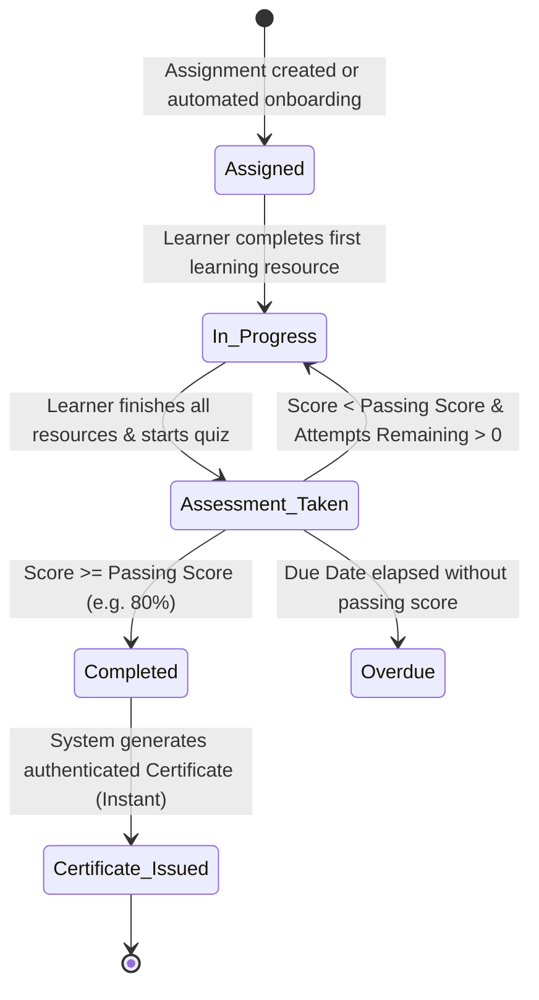

# CollabCRM People Training Module - Developer Flow & Field Specification

## Document Overview
This document specifies the exact end-to-end user navigation flow, screen transitions, action triggers, and form field specifications for the **Training Module** within CollabCRM. It is structured directly according to product acceptance criteria and field validation standards for developers.

---

## SECTION 1: SYSTEM NAVIGATION & USER FLOWS

### Flow 1: Accessing Training Module
**User Type:** Company Admin / HR Manager / Employee  
**Acceptance Criteria:**
1. **Navigation:** User clicks on `People` from the left main navigation bar.
2. Under `People`, user clicks on `Training Module`.
3. Clicking on `Training Module` opens a dedicated side panel drawer with the following sub-modules:
   - a. `Dashboard`
   - b. `Training Management`
   - c. `Assignments`
   - d. `Training Progress`
   - e. `Certificates`
   - f. `Reports`
4. By default, `Dashboard` is selected and loaded as the active screen.

---

### Flow 2: Dashboard Overview Flow
**User Type:** Company Admin / HR Manager  
**Acceptance Criteria:**
1. **Navigation:** `People > Training Module > Dashboard`.
2. User lands on the Dashboard screen.
3. System displays 4 high-level KPI metric cards at the top:
   - `Total Programmes` (Count of all active and draft programmes).
   - `Active Enrollments` (Count of all active learner assignments).
   - `Overdue Assignments` (Count of learners past due date without completion).
   - `Avg. Completion Rate` (Overall percentage progress across all learners).
4. System displays 3 visual analytic sections:
   - `Department Completion Matrix` (Bar graph of completion rates by department).
   - `Enrollment Status Distribution` (Pie/donut chart: Not Started, In Progress, Completed, Overdue).
   - `Quick Action Shortcuts` (Direct navigation links to `+ Create Programme` and `Training Progress`).

---

### Flow 3: Training Management (Programme Catalogue & Create Flow)
**User Type:** Company Admin / HR Manager  
**Acceptance Criteria:**
1. **Navigation:** `People > Training Module > Training Management`.
2. User lands on the **Training Programmes Catalogue** screen.
3. User sees:
   - Header title: `Training Programmes` with count badge (e.g., `12 Programmes`).
   - Filter chips: `All`, `Published`, `Draft`.
   - Search input: `Filter results...`.
   - Filter button: Opens category/difficulty filter dropdown.
   - Primary Action Button: `+ Create Programme`.
4. Table displays all programmes in tabular form with the following columns:
   1. `No.` (Row index, e.g., 1, 2, 3...)
   2. `Programme Name ↕` (Programme Title with version tag, e.g., `v1.0`)
   3. `Level ↕` (Badge: Beginner, Intermediate, or Advanced)
   4. `Duration ↕` (Expected duration in hours, e.g., `4 hrs`)
   5. `Enrolled ↕` (Count of enrolled employees)
   6. `Status ↕` (Pill: `Published` in green, `Draft` in amber)
   7. `Actions`:
      - Active/Inactive toggle switch (instantly toggles between Published and Draft).
      - View Programme icon (eye icon): opens programme detail view.
      - Edit Programme icon (pencil icon): opens programme editor.
5. **Create Programme Flow:**
   - User clicks `+ Create Programme` button at the top right.
   - System navigates user to the screen: `Training Programmes › Create Programme`.
   - Top action bar contains:
     - `Auto-Fill Demo` button (populates test data for quick validation).
     - `Cancel` button (returns to Catalogue without saving).
     - `Publish Programme` split button (options: `Publish Programme` or `Save Draft`).
   - The form is divided into 3 sequential sections:
     - **Section 1: 1. CORE PROGRAMME DETAILS**
       - User enters Programme Name.
       - User selects Training Category from dropdown.
       - User selects Difficulty Level from dropdown.
       - User enters Expected Duration (Hours).
       *(Note: Passing Assessment Score and Per-Programme limits are excluded from this section).*
     - **Section 2: 2. LEARNING RESOURCES (YOUTUBE, EXTERNAL COURSES, WEBSITES, VIDEOS, PDFS, DOCS) \***
       - User sees existing resource rows or clicks `+ Add Learning Resource` to append a new row.
       - For each resource row, user selects Resource Type, enters Module Title, and enters Resource URL.
       - User can click the `X` button on any row to delete that resource.
     - **Section 3: 3. ASSESSMENT & QUESTIONS**
       - User toggles `Enable Assessment` (default is ON).
       - When ON, user configures:
         - `Assessment Title *`
         - `Passing Score (%) *`
         - `Max Assessment Attempts *`
       - User enters `Assessment Description` in the full-width textarea directly below the 3 parameter inputs.
       - Under `QUESTIONS LIST`, user sees total questions count and total marks badges.
       - User clicks `+ Add Question` to append a question block.
       - For each question block:
         - User enters `Marks` (numeric).
         - User checks/unchecks `Mandatory`.
         - User enters `Question Statement *`.
         - User adds options (Option 1, Option 2, etc.), sets option text, and clicks the radio button to designate the correct answer.
         - User can click `Duplicate` to clone or `Delete` to remove the question.
   - User clicks `Publish Programme`:
     - System validates all mandatory fields.
     - System creates the programme record, sets status to `Published`, and redirects user back to `Training Management` catalogue.

---

### Flow 4: Assignments Screen Flow
**User Type:** Company Admin / HR Manager  
**Acceptance Criteria:**
1. **Navigation:** `People > Training Module > Assignments`.
2. User lands on the **Assignments** screen.
   *(Note: The top-right `+ Assign Training` button is removed. Assignments are listed in read-only and inspection mode).*
3. Top filter bar contains:
   - Counter badge: `41 Total`.
   - Search input: `Filter employee or training...`.
   - Dropdown filter 1: `All Departments` (Engineering, Recruitment & HR, Sales & BD, Business Analyst, etc.).
   - Dropdown filter 2: `All Assignments` (All Assignments, Mandatory, Elective, Overdue).
4. Table displays all assignments in tabular form with the following columns:
   1. `EMPLOYEE` (Avatar with user initials, Employee Name, Designation/Role).
   2. `DEPARTMENT` (Department Name).
   3. `ASSIGNED TRAINING` (Programme Title, Level, Duration).
   4. `ASSIGNED DATE` (Formatted date: `YYYY-MM-DD` or `DD-MMM-YYYY`).
   5. `DUE DATE` (Target completion date).
   6. `TYPE` (Badge: `Mandatory` in rose or `Elective` in slate).
   7. `PROGRESS` (Numeric percentage e.g. `75%` with visual color progress bar).
   8. `ACTIONS`: Contains **only** the `View Assignment Details` eye icon.
      *(Note: Reassign and Delegate Reviewer icons are removed).*
5. **View Details Flow:**
   - User clicks the `View Assignment Details` eye icon in any row.
   - System opens a slide-over drawer / modal showing:
     - Employee profile summary (Name, Department, Email).
     - Assigned programme syllabus and learning modules checklist.
     - Completion percentage breakdown.
     - Assessment attempt history and score.
     - Action button: `Send Reminder` (dispatches in-app and email reminder to learner).
     - Close button (`X`): closes the modal and returns user to the table.

---

### Flow 5: Training Progress (Dual-Mode Tracker Flow)
**User Type:** Company Admin / HR Manager / Department Lead  
**Acceptance Criteria:**
1. **Navigation:** `People > Training Module > Training Progress`.
2. In the side panel, the sub-module label is **`Training Progress`** on a single line.
3. User lands on the **Training Progress** screen.
4. Screen header contains:
   - Title: `Training Progress`.
   - Subtitle: `Granular employee and programme progress tracking and completion analytics across all enrollments.`
   - Segmented Dual-View Toggle:
     - `[ Employee-wise ]`
     - `[ Programme-wise ]`
5. **When `Employee-wise` is selected (Default Mode):**
   - Subheader shows: `Employee Training Progress Tracker` with record count (e.g. `41 Records`).
   - Filters:
     - Search input: `Filter employee name or email...`.
     - Department dropdown: `All Departments`, `Engineering`, `HR`, etc.
     - Training Status dropdown: `All Statuses`, `Not Started`, `In Progress`, `Completed`, `Overdue`.
     - Certificate Status dropdown: `All Certificate Statuses`, `Issued`, `Pending`, `None`.
   - Tabular columns:
     1. `EMPLOYEE NAME` (Avatar, Full Name, Email).
     2. `DEPARTMENT` (Department Name).
     3. `ASSIGNED TRAINING` (Programme Title).
     4. `ASSIGNMENT DATE` (Date assigned).
     5. `DUE DATE` (Due date).
     6. `COMPLETION %` (Progress percentage with progress bar).
     7. `TRAINING STATUS` (Pill: `Completed`, `In Progress`, `Not Started`, `Overdue`).
     8. `SUBMISSION STATUS` (Pill: `Approved`, `Auto-Evaluated`, `In Progress`).
     9. `CERTIFICATE STATUS` (Pill: `Issued` in purple, `Pending`, or `None`).
     10. `ACTION` (View icon to inspect individual learner progress).
6. **When `Programme-wise` is selected:**
   - Subheader shows: `Programme Training Progress Tracker` with programme count (e.g. `12 Programmes`).
   - Search input: `Filter programmes...`.
   - Tabular / Card catalogue of all 12 programmes with the following columns:
     1. `PROGRAMME NAME` (Title, Category, Version tag).
     2. `DIFFICULTY & DURATION` (Level badge and expected hours).
     3. `ENROLLED LEARNERS` (Count of learners assigned).
     4. `COMPLETED LEARNERS` (Count of learners who completed).
     5. `AVERAGE COMPLETION %` (Aggregated percentage with progress bar).
     6. `STATUS` (Published / Draft badge).
     7. `ACTIONS`: `View Enrolled Learners` button.
   - **Inspection Flow:**
     - User clicks `View Enrolled Learners`.
     - System opens modal listing all employees assigned to that programme, their individual progress bars, assessment scores, and completion dates.

---

### Flow 6: Certificates Flow (Automated Flow)
**User Type:** Company Admin / HR Manager / Employee Learner  
**Acceptance Criteria:**
1. **Navigation:** `People > Training Module > Certificates`.
2. **Automated Issuance Rule (No Manual Review Queue):**
   - When a learner completes all mandatory resources and scores $\ge$ the passing score on the assessment, the system **automatically** generates the certificate.
   - Manual management review queues, evaluator approval steps, and manual certificate assignment links do **not** exist.
3. User lands on the **Certificates** screen.
4. Top controls: Search by Certificate ID or recipient name, filter by programme.
5. Tabular listing of all issued certificates with columns:
   1. `CERTIFICATE ID` (e.g., `CERT-2026-0812`).
   2. `RECIPIENT NAME` (Avatar and Learner Name).
   3. `PROGRAMME NAME` (Title of completed training).
   4. `COMPLETION DATE` (Date assessment was passed).
   5. `SCORE ACHIEVED` (e.g., `85% (Pass: 80%)`).
   6. `VERIFICATION HASH` (Tamper-evident verification code).
   7. `ACTIONS`:
      - `View Certificate` (opens formatted certificate modal).
      - `Download PDF` (downloads authenticated PDF certificate).

---

### Flow 7: Employee Profile Module Integration Flow
**User Type:** Employee Learner / Manager / HR  
**Acceptance Criteria:**
1. **Navigation:** User navigates to `People > Employees`.
2. User clicks on any employee row to open the **Employee Detail Profile** screen.
3. In the profile tabs row, two training tabs are present:
   - **Tab A: `Training History`**:
     - User clicks `Training History`.
     - System displays a table of all training programmes assigned to this employee:
       - Columns: `Programme Title`, `Category`, `Level`, `Assigned Date`, `Due Date`, `Progress %`, `Status`, `Score`, `Action`.
       - Action: `Resume Training` (for active trainings) or `View Syllabus` (for completed trainings).
   - **Tab B: `My Certificates`**:
     - User clicks `My Certificates`.
     - System displays a card grid of all certificates earned by this employee.
     - Each card displays certificate badge, programme name, completion date, score, and buttons to `View Certificate` and `Download PDF`.

---

### Flow 8: Configuration Module Updates Flow
**User Type:** Company Admin  
**Acceptance Criteria:**
1. **Navigation:** User clicks `Config` from the main navigation.
2. Under `Config`, user navigates to:
   - **Screen A: `Config > Training Config`**:
     - User configures system-wide training parameters:
       - Default Due Period (Days).
       - Automated Certification (ON/OFF).
       - Reminder Notifications Cadence (7, 3, 1 Days).
       - Certificate Template selection.
     - User clicks `Save Settings`.
   - **Screen B: `Config > Roles`**:
     - User navigates to `Config > Roles`.
     - User creates or selects a role (e.g., `Training Admin`, `Department Manager`, `Employee Learner`).
     - In the permissions matrix, user assigns specific permissions:
       - `training.programmes.manage` (Create, edit, delete programmes).
       - `training.assignments.view` (View assignments list).
       - `training.progress.view` (View progress tracker).
       - `training.certificates.manage` (Download and verify certificates).

---

## SECTION 2: FORM FIELD VALUES & VALIDATION SPECIFICATIONS

### 1. Create Training Programme Form (`Training Management > Create Programme`)

#### Section 1: Core Programme Details
- **Programme Name:**
  - Mandatory: Yes
  - Type: Alphanumeric with standard punctuation
  - Max. Length: 120
  - Min. Length: 3
  - Default value: NA (Empty)
  - Validation: Cannot be blank, whitespace-only, or contain leading/trailing whitespaces. Must be unique across active programmes.

- **Training Category:**
  - Mandatory: Yes
  - Type: Dropdown (Single Select)
  - Max. Length: NA
  - Default value: `Recruitment & HR Operations`
  - Allowed Values:
    - `Recruitment & HR Operations`
    - `Engineering & Architecture`
    - `Security & Compliance`
    - `Sales & BD`
    - `Executive Leadership`

- **Difficulty Level:**
  - Mandatory: Yes
  - Type: Dropdown (Single Select)
  - Max. Length: NA
  - Default value: `Intermediate`
  - Allowed Values:
    - `Beginner`
    - `Intermediate`
    - `Advanced`

- **Expected Duration (Hours):**
  - Mandatory: Yes
  - Type: Numeric (Integer)
  - Max. Value: 200
  - Min. Value: 1
  - Default value: `4`
  - Validation: Positive integer only; decimals or negative numbers not permitted.

---

#### Section 2: Learning Resources Builder
- **Resource Type:**
  - Mandatory: Yes
  - Type: Dropdown (Single Select)
  - Max. Length: NA
  - Default value: `Video / YouTube`
  - Allowed Values:
    - `Video / YouTube`
    - `PDF Document`
    - `External Course / Website`
    - `Interactive Assessment / Sandbox`

- **Resource Module Title:**
  - Mandatory: Yes
  - Type: Alphanumeric
  - Max. Length: 120
  - Min. Length: 2
  - Default value: NA (Empty)
  - Validation: Must describe the curriculum resource clearly.

- **Resource URL / Link:**
  - Mandatory: Yes
  - Type: URL
  - Max. Length: 500
  - Min. Length: 8
  - Default value: NA (Empty)
  - Validation: Must be a valid absolute URI starting with `http://` or `https://`.

---

#### Section 3: Assessment & Questions Builder
- **Enable Assessment Toggle:**
  - Mandatory: Yes
  - Type: Boolean Toggle
  - Default value: `ON` (true)
  - Allowed Values: `true` / `false`

- **Assessment Title:**
  - Mandatory: Yes (when Enable Assessment is ON)
  - Type: Alphanumeric
  - Max. Length: 120
  - Min. Length: 3
  - Default value: `Final Training Assessment`
  - Validation: Required if assessment toggle is ON.

- **Passing Score (%):**
  - Mandatory: Yes (when Enable Assessment is ON)
  - Type: Numeric (Integer percentage)
  - Max. Value: 100
  - Min. Value: 1
  - Default value: `80`
  - Validation: Score required for automated passing and certification. Must be strictly between 1 and 100.

- **Max Assessment Attempts:**
  - Mandatory: Yes (when Enable Assessment is ON)
  - Type: Numeric (Integer)
  - Max. Value: 10
  - Min. Value: 1
  - Default value: `3`
  - Validation: Number of attempts permitted before requiring supervisor reassignment.

- **Assessment Description:**
  - Mandatory: No (Optional)
  - Type: Alphanumeric / Textarea
  - Max. Length: 500
  - Min. Length: 0
  - Default value: `Complete the following questions to evaluate your understanding of this training.`
  - Validation: Placed full-width directly below the three parameter fields.

- **Question Statement:**
  - Mandatory: Yes
  - Type: Alphanumeric / Textarea
  - Max. Length: 1000
  - Min. Length: 5
  - Default value: NA (Empty)
  - Validation: Question text prompt displayed to learner.

- **Question Marks:**
  - Mandatory: Yes
  - Type: Numeric (Integer)
  - Max. Value: 100
  - Min. Value: 1
  - Default value: `2`
  - Validation: Point weighting for the question.

- **Mandatory Question Checkbox:**
  - Mandatory: No
  - Type: Boolean
  - Default value: `true`
  - Allowed Values: `true` / `false`

- **Question Option Text:**
  - Mandatory: Yes (minimum 2 options per question)
  - Type: Alphanumeric
  - Max. Length: 250
  - Min. Length: 1
  - Default value: NA (Empty)
  - Validation: Each question must contain between 2 and 6 options. Exactly one option must be selected as the correct answer.

---

### 2. Global Training Configuration Form (`Config > Training Config`)

- **Default Due Period (Days):**
  - Mandatory: Yes
  - Type: Numeric (Integer)
  - Max. Value: 365
  - Min. Value: 1
  - Default value: `14`
  - Validation: Number of calendar days added to assignment date to compute due date.

- **Automated Certification Toggle:**
  - Mandatory: Yes
  - Type: Boolean Toggle
  - Default value: `ON` (true)
  - Allowed Values: `true` / `false`
  - Validation: When ON, certificates are generated automatically upon assessment pass without human review.

- **Email Reminder Cadence:**
  - Mandatory: Yes
  - Type: Multi-select Checkbox / Chips
  - Default value: `[7, 3, 1]`
  - Allowed Values: `14 Days`, `7 Days`, `3 Days`, `1 Day`, `On Due Date`, `Overdue Daily`

- **Certificate Template:**
  - Mandatory: Yes
  - Type: Dropdown (Single Select)
  - Default value: `Standard Corporate Blue`
  - Allowed Values:
    - `Standard Corporate Blue`
    - `Executive Gold`
    - `Technical Minimalist`

---

## SECTION 3: SYSTEM INTEGRATIONS & STATE TRANSITIONS

