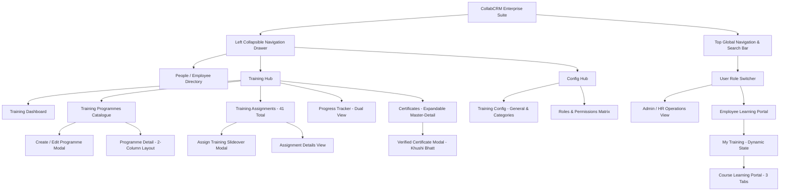
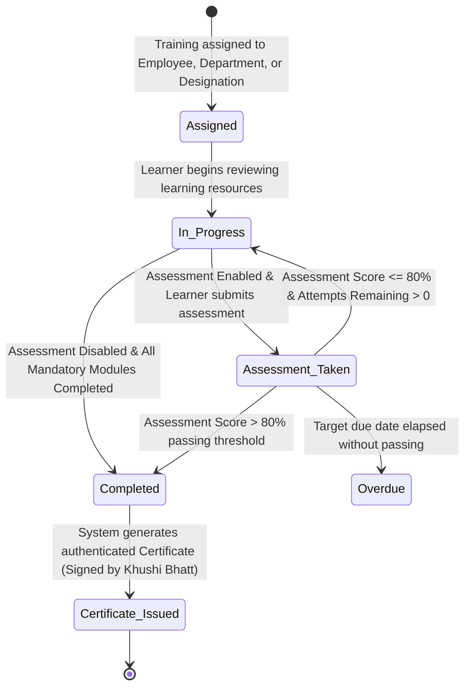

# CollabCRM People Training Module - Developer Flow & Field Specification

## Document Overview
This document specifies the exact developer architecture, screen flows, user roles, data schemas, validation rules, and dynamic interactions for the **CollabCRM People & Training Module**. Every field, allowed value, form control, and layout matches the live implementation prototype.

---

## SECTION 1: SYSTEM NAVIGATION & SCREEN FLOWS

### Flow 1: Top Navigation & Role Switching
- **Global Header**: Contains company branding (`CollabCRM People`), global search (`Search employees, programmes`), notifications bell, and the Active User Profile indicator (`Tanya Kapoor - Business Analyst • Employee` or `Ishdeep Anand - Admin • Management`).
- **Role Switching**: Clicking the user badge toggles between **Admin/HR View** and **Employee User Role View**. Switching to an Employee role redirects directly to the Employee Dashboard and personal learning workflows.

---

### Flow 2: Navigation Drawer Structure
The left collapsible sidebar provides access to:
1. **Employees** (`employees`): Complete employee directory with profile cards and Add Employee modal.
2. **Training Hub**:
   - **Dashboard** (`training-dashboard`): Real-time metrics (Active Learners, Total Assignments, Completion Rate, Average Score), urgent review queue, and performance analytics.
   - **Training Programmes** (`training-programmes`): Full course catalogue, status filters (All, Published, Draft, Archived), search, and "+ Create Programme" action.
   - **Assignments** (`training-assignments`): Central assignment register with **`ASSIGNED SCOPE`** column (Employee, Department, Designation), `41 Total` assignment count, and 5-page pagination (10 items/page).
   - **Progress** (`training-progress`): Dual-mode tracking (Department Analytics vs Employee-wise Completion view).
   - **Certificates** (`certificates`): Expandable master-detail table matching Screenshot 3 format (`^ / v` toggle chevron, plain-text earned programmes, and right-aligned Actions column directly under `All Records`).
3. **Config Hub**:
   - **Training Config** (`config`): Tabbed settings for **General Settings** (5 module access permission toggles) and **Training Categories** (master category table + Add Category modal with duplicate validation).
   - **Roles & Permissions** (`roles`): System roles matrix (Administrator, Senior Recruiter, CEO, Project Manager, BDE, Admin/HR, Employee, Team Leader, Management).
*(Note: The legacy "Reports" drawer item has been removed.)*

---

### Flow 3: Training Management (Create / Edit Programme Flow)
- Access via `Training Programmes > + Create Programme` or `Edit Programme`.
- Features an **Auto-Fill Demo** button to rapidly populate sample data.
- Structured across three core sections:
  1. **Core Programme Details**: Programme Name, Category, Difficulty Level, Expected Duration.
  2. **Learning Resources Builder**: Dynamic resource repeater (Video/YouTube, PDF Document, External Link, Article).
  3. **Assessment & Questions Builder**: Enable Assessment toggle, title, passing score, max attempts, description, and dynamic multi-format question builder.
- Header Actions: `Auto-Fill Demo`, `Cancel`, `Save as Draft`, and `Publish Programme` (or `Update & Publish`).

---

### Flow 4: Assign Training Slideover Modal Flow
- Access via `+ Assign Training` button in Header, Training Programmes, or Assignments table.
- Configurable targeting parameters:
  - Select Programme dropdown.
  - Multi-select Department filter with dynamic employee counter.
  - Multi-select Designation filter.
  - Multi-select Employee list with "Select All / Deselect All" shortcut.
  - Mandatory Start Date and optional End Date.
- Action Buttons: `Cancel` and `Assign Training`.

---

### Flow 5: Certificates Verification Flow
- **Master-Detail Expandable Table**:
  - Master row displays Employee Name, Department/Role, Primary Earned Programme, and an expand toggle (`^ / v`).
  - Expanding reveals child sub-rows for all additional certificates earned by that employee.
  - Plain-text format for programme names (no select dropdowns or passed badges in cell).
  - **Right-Aligned Actions**: The `Actions` column header and eye icon `(👁)` buttons are aligned to the far right edge (`w-28 text-right pr-6`), positioned directly below the `All Records` category filter.
- **Certificate Modal**:
  - Displays official certificate of appreciation.
  - Dynamically bound to the exact completed programme and learner name.
  - **Authorized Signatory**: Configured strictly as **`Khushi Bhatt, Head of HR`**.

---

### Flow 6: Employee User Role Learning Portal Flow
- Access by switching user to `Tanya Kapoor` or navigating to `My Training`.
- **Dynamic State Integration**: Newly created and published programmes from Admin/HR view automatically populate in the employee's training list.
- **3-Tab Course Learning Layout (`mt`)**:
  - **Tab 1: 1. Overview**: Progress bar, completed modules counter, course summary, and objectives.
  - **Tab 2: 2. Learning Resources**: Resource checklist with external link openers, checkable completion toggles, and mandatory indicators.
  - **Tab 3: 3. Assessment & Questions**:
    - **Header**: Clean title **`3. Assessment & Questions`** with no `[Unlocked]` tag.
    - **When Assessment Toggle is OFF (`enabled: false`)**:
      - Inside Tab 3: Renders a clean empty container (*"No Assessment Configured — Assessment is disabled for this training programme. Learners achieve completion upon reviewing all mandatory learning resources"*). **No questions, no scoring inputs, no submit button.**
      - Left Sidebar: Passing Assessment Score displays `N/A (Assessment Disabled)`. Action button displays `Start Learning Modules →` or `Programme Completed ✓` (never prompts to take an assessment).
      - Tab 2 Navigation: Bottom button displays `All Modules Completed ✓`.
    - **When Assessment Toggle is ON (`enabled: true`)**:
      - Inside Tab 3: Renders the exact question types, marks, mandatory indicators, and options configured by Admin/HR.
      - Left Sidebar: Passing Assessment Score displays `🎯 80% (Strictly > 80% to pass)`. Action button displays `Take Assessment →` (or `Download Certificate 🎓` upon passing).

---

## SECTION 2: FORM FIELD VALUES & VALIDATION SPECIFICATIONS

### 1. Create Training Programme Form (`Training Management > Create Programme`)

#### Section 1: Core Programme Details
- **Programme Name:**
  - Mandatory: Yes (`*`)
  - Type: Alphanumeric
  - Max. Length: 120
  - Min. Length: 3
  - Default value: Empty
  - Validation: Cannot be blank or whitespace-only. Must be unique across active programmes.

- **Training Category:**
  - Mandatory: Yes (`*`)
  - Type: Dropdown (Single Select)
  - Default value: `Recruitment & HR Operations`
  - Allowed Values:
    - `Recruitment & HR Operations`
    - `Engineering & Tech Architecture`
    - `Sales & Business Development`
    - `Governance & Compliance`
    - `Product & Design`

- **Difficulty Level:**
  - Mandatory: Yes (`*`)
  - Type: Dropdown (Single Select)
  - Default value: `Intermediate`
  - Allowed Values:
    - `Beginner`
    - `Intermediate`
    - `Expert`

- **Expected Duration (Hours):**
  - Mandatory: Yes (`*`)
  - Type: Numeric (Integer)
  - Max. Value: 200
  - Min. Value: 1
  - Default value: `4`
  - Validation: Positive integer; decimals or negative values not permitted.

---

#### Section 2: Learning Resources Builder
- **Resource Type:**
  - Mandatory: Yes
  - Type: Dropdown (Single Select)
  - Default value: `Video / YouTube`
  - Allowed Values:
    - `Video / YouTube`
    - `PDF Document`
    - `External Link`
    - `Article`

- **Resource Title:**
  - Mandatory: Yes
  - Type: Alphanumeric
  - Max. Length: 150
  - Min. Length: 2
  - Default value: Empty (Placeholder: `e.g. Module 1: Architecture Video Lecture`)
  - Validation: Clear module identifier.

- **Resource URL:**
  - Mandatory: Yes
  - Type: URL
  - Max. Length: 500
  - Min. Length: 8
  - Default value: Empty (Placeholder: `https://...`)
  - Validation: Must be a valid URI (`http://` or `https://`).

---

#### Section 3: Assessment & Questions Builder
- **Enable Assessment Toggle:**
  - Mandatory: Yes
  - Type: Boolean Toggle (Active / Inactive)
  - Default value: `Active` (`true`)

- **Assessment Title:**
  - Mandatory: Yes (when Enable Assessment is ON)
  - Type: Alphanumeric
  - Max. Length: 120
  - Min. Length: 3
  - Default value: `Final Training Assessment`

- **Passing Score (%):**
  - Mandatory: Yes (when Enable Assessment is ON)
  - Type: Numeric (Integer)
  - Max. Value: 100
  - Min. Value: 1
  - Default value: `80`
  - Validation: Benchmark passing percentage (strictly > 80% required for automatic certification).

- **Max Assessment Attempts:**
  - Mandatory: Yes (when Enable Assessment is ON)
  - Type: Numeric (Integer)
  - Max. Value: 10
  - Min. Value: 1
  - Default value: `3`
  - Validation: Maximum attempts permitted before supervisor intervention.

- **Assessment Description:**
  - Mandatory: No (Optional)
  - Type: Textarea
  - Max. Length: 500
  - Default value: `Complete the following questions to evaluate your understanding of this training.`

- **Question Statement:**
  - Mandatory: Yes (`*`)
  - Type: Alphanumeric / Textarea
  - Max. Length: 1000
  - Min. Length: 5
  - Default value: Empty

- **Question Type:**
  - Mandatory: Yes (`*`)
  - Type: Dropdown (Single Select)
  - Default value: `Single Selection (Radio)`
  - Allowed Values:
    1. `Short Text Answer` (`short_text`)
    2. `Long Text Answer` (`long_text`)
    3. `Single Selection (Radio)` (`single_choice`)
    4. `Multiple Selection (Checkbox)` (`multiple_choice`)
    5. `Dropdown Menu` (`dropdown`)
    6. `True / False` (`true_false`)

- **Question Marks:**
  - Mandatory: Yes
  - Type: Numeric (Integer)
  - Max. Value: 50
  - Min. Value: 1
  - Default value: `2`

- **Mandatory Question Toggle:**
  - Mandatory: Yes
  - Type: Boolean Toggle
  - Default value: `true`

- **Question Options / Answers:**
  - For `single_choice`, `multiple_choice`, and `dropdown`: Minimum 2 options required, each with Option Text. Single choice and dropdown require a selected Correct Answer; multiple choice requires at least one selected Correct Answer.
  - For `short_text`: Minimum 1 accepted keyword/phrase for automated grading.
  - For `true_false`: Correct answer toggle (`True` or `False`).
  - For `long_text`: Expected response rubric summary.

---

### 2. Assign Training Form (`Assignments > + Assign Training`)

- **Training Programme:**
  - Mandatory: Yes (`*`)
  - Type: Dropdown (Single Select bound to published programmes)
  - Default value: First active published programme

- **Department Filter:**
  - Mandatory: No (Optional targeting filter)
  - Type: Multi-select Dropdown with Select All
  - Default value: `All Departments`
  - Allowed Values: `Project`, `Business analyst`, `Recruitment & HR`, `CPA Firms`, `Admin`

- **Designation Filter:**
  - Mandatory: No (Optional targeting filter)
  - Type: Multi-select Dropdown with Select All
  - Default value: `All Designations`
  - Allowed Values: `Executive`, `Sr. Executive`, `Business analyst`, `Team leader`, `Manager`, `AVP`

- **Employee(s):**
  - Mandatory: Yes (`*`)
  - Type: Multi-select Dropdown with Select All / Deselect All
  - Default value: Primary selected employee
  - Validation: Must have at least 1 employee selected before assignment submission. Displays reactive count (e.g. `14 selected`).

- **Start Date:**
  - Mandatory: Yes (`*`)
  - Type: Date (YYYY-MM-DD)
  - Default value: Current system date (`2026-11-04`)
  - Validation: Cannot be empty.

- **End Date:**
  - Mandatory: No (Optional completion deadline)
  - Type: Date (YYYY-MM-DD)
  - Default value: Current date + default assignment period (`2026-12-01`)
  - Validation: Must be on or after Start Date.

---

### 3. Add Employee Form (`Employees > + Add New Employee`)

- **First Name:**
  - Mandatory: Yes (`*`)
  - Type: Alphabetic
  - Max. Length: 50
  - Min. Length: 2
  - Default value: Empty

- **Last Name:**
  - Mandatory: Yes (`*`)
  - Type: Alphabetic
  - Max. Length: 50
  - Min. Length: 2
  - Default value: Empty

- **Company Email:**
  - Mandatory: Yes (`*`)
  - Type: Email address
  - Max. Length: 100
  - Default value: Empty
  - Validation: Must be a valid corporate email format (`user@domain.com`).

- **Department:**
  - Mandatory: Yes (`*`)
  - Type: Dropdown (Single Select)
  - Default value: `Project`
  - Allowed Values: `Project`, `Business analyst`, `Recruitment & HR`, `CPA Firms`, `Admin`

- **Designation:**
  - Mandatory: Yes (`*`)
  - Type: Dropdown (Single Select)
  - Default value: `Executive`
  - Allowed Values: `Executive`, `Sr. Executive`, `Business analyst`, `Team leader`, `Manager`, `AVP`

- **Status:**
  - Mandatory: Yes (`*`)
  - Type: Dropdown (Single Select)
  - Default value: `Confirmed`
  - Allowed Values: `Confirmed`, `Probation`, `Notice Period`

- **Reporting To:**
  - Mandatory: Yes (`*`)
  - Type: Dropdown (Single Select bound to management users)
  - Default value: `Isha Patel`

- **Company Mobile:**
  - Mandatory: No (Optional)
  - Type: Phone number
  - Default value: `+1 9005049999`

---

### 4. Global Training Configuration (`Config > Training Config`)

#### General Settings Tab (`t === 'general'`)
- **Enable / Disable Training Module:**
  - Mandatory: Yes
  - Type: Boolean Toggle (Active / Inactive)
  - Default value: `Active` (`true`)
  - Description: Master switch to enable or disable the entire Training module access across the portal.

- **Allow Training Creation:**
  - Mandatory: Yes
  - Type: Boolean Toggle
  - Default value: `Active` (`true`)
  - Description: Permit authorized roles to author and create new training programmes.

- **Allow Training Editing:**
  - Mandatory: Yes
  - Type: Boolean Toggle
  - Default value: `Active` (`true`)
  - Description: Allow modification of existing published and draft training programmes.

- **Allow Training Archiving:**
  - Mandatory: Yes
  - Type: Boolean Toggle
  - Default value: `Inactive` (`false`)
  - Description: Allow archiving and retiring deprecated curriculum records.

- **Enable Preview Mode:**
  - Mandatory: Yes
  - Type: Boolean Toggle
  - Default value: `Active` (`true`)
  - Description: Permit author preview before publishing changes.

#### Training Categories Tab (`t === 'categories'`)
- **Category Name:**
  - Mandatory: Yes (`*`)
  - Type: Alphanumeric
  - Max. Length: 80
  - Min. Length: 3
  - Validation: Case-insensitive unique check against all existing categories. Repeating category names are rejected with an alert.
- **Description:**
  - Mandatory: No (Optional)
  - Type: Textarea
  - Max. Length: 300
  - Default value: `New training category description.`
- **Status:**
  - Mandatory: Yes
  - Type: Boolean Toggle
  - Default value: `Active` (`true`)

---

### 5. Role-Based Access Control (`Config > Roles`)
- Standardized System Roles Matrix:
  1. **Administrator**: Full access across all modules, configuration, and employee management.
  2. **Manager / Reviewer**: Access to team assignments, progress tracking, and evaluation review queue.
  3. **Standard Employee**: Personal learning portal, assigned coursework, and earned certificates.
  4. Specialized Roles: Sr. Business Analyst, Senior Recruiter, CEO, Project Manager, BDE, Team Leader, Management.

---

### 6. Certificate Verification & Credential Specifications
- **Certificate ID:**
  - Format: `TRN-{YYYY}-{serial}` (e.g. `TRN-2026-0027`, `TRN-2026-0032`)
- **Authorized Signatory:**
  - Full Name & Title: **`Khushi Bhatt, Head of HR`**
- **Issued Date:**
  - Format: `DD-MMM-YYYY` (e.g. `27-Jan-2026`)
- **Master-Detail Table Layout:**
  - Left columns: No. (`1, 2, 3...`), Employee Avatar & Name, Department / Role.
  - Middle column: Programme Name (plain-text format, no dropdowns or passed badges).
  - Far-right column: `Actions` header and eye icon `(👁)` buttons right-aligned at `w-28 text-right pr-6`, positioned directly beneath `All Records`.

---

## SECTION 3: SYSTEM INTEGRATIONS & STATE TRANSITIONS

---

## SECTION 4: ASSESSMENT & PORTAL DYNAMIC BEHAVIORAL SPECIFICATIONS

### 4.1 Assessment Toggle State Matrix
| System Component | Assessment Toggle: ON (`enabled: true`) | Assessment Toggle: OFF (`enabled: false`) |
| :--- | :--- | :--- |
| **Tab 3 Header** | `3. Assessment & Questions` (clean title; no `[Unlocked]` tag) | `3. Assessment & Questions` (clean title; no `[Unlocked]` tag) |
| **Tab 3 Content** | Renders full evaluation card, attempt counter, passing criteria, and all configured questions | **Empty State Container**: "No Assessment Configured" message with icon; **no questions, no scoring inputs, no submit button** |
| **Left Sidebar Action Button** | "Take Assessment →" (or "Download Certificate 🎓" when passed) | "Start Learning Modules →" (or "Programme Completed ✓" when all modules done) |
| **Passing Score Display** | `🎯 {passingScore}% (Strictly > 80% to pass)` | `N/A (Assessment Disabled)` |
| **Tab 2 Navigation Button** | "Proceed to Assessment →" | "All Modules Completed ✓" |
| **Completion Criteria** | 100% Mandatory Resources + Passing Score on Assessment | 100% Mandatory Resources Reviewed |

### 4.2 Dynamic Question Format Parity
1. **Short Text (`short_text`)**: Single-line text input with case-insensitive accepted answer evaluation.
2. **Long Text (`long_text`)**: Multi-line textarea for detailed subjective responses.
3. **Single Choice (`single_choice`)**: Radio group with option labels and single select state.
4. **Multiple Choice (`multiple_choice`)**: Checkbox group supporting multiple selections with array equality grading.
5. **Dropdown (`dropdown`)**: Standard select menu with placeholder `-- Select Answer --` and option values.
6. **True / False (`true_false`)**: Dual toggle buttons/radios for binary verification.
7. **Marks & Mandatory Indicators**: Every question displays its designated marks (`X Marks`) and mandatory status (`• Mandatory`).

### 4.3 Assignments Table Specifications
- **Column Header**: **`ASSIGNED SCOPE`** (synchronized across all multi-entity assignment types: Employee, Department, Designation).
- **Total Record Count**: **`41 Total`** assignments.
- **Pagination**: Complete 5-page pagination (10 items per page with reactive Previous/Next and page number indicators).
