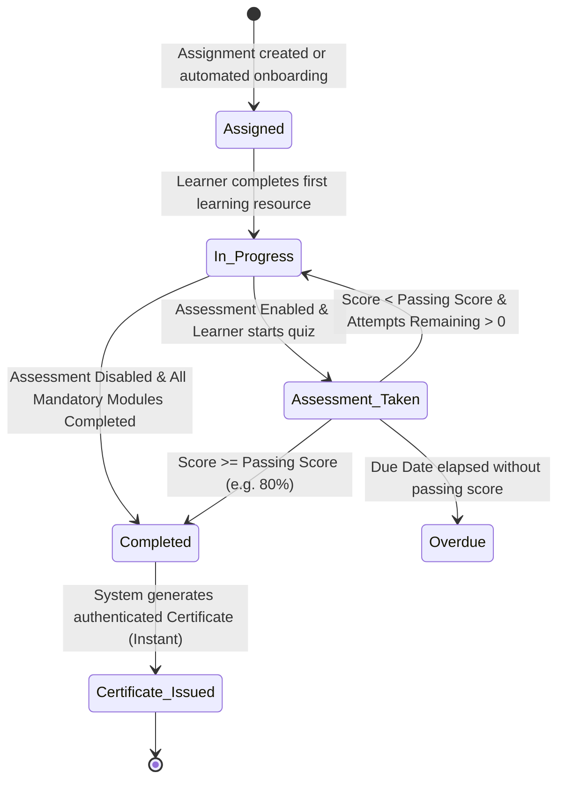

# CollabCRM People Training Module - Developer Flow & Field Specification

## Document Overview
This document specifies the exact end-to-end user navigation flow, screen transitions, action triggers, and form field specifications for the **Training Module** within CollabCRM. It is structured directly according to product acceptance criteria and field validation standards for developers.

---

## SECTION 1: SYSTEM NAVIGATION & USER FLOWS

### Flow 1: Accessing Training Module & Department Setup
**User Type:** Company Admin / HR Manager / Employee  
**Acceptance Criteria:**
1. **Navigation:** User navigates to `People` from the left main navigation bar.
2. Under `People > Employees`:
   - System displays all employees in tabular form with verified IT-related departments (`Infrastructure`, `Project`, `Quality Assurance`, `Cloud & DevOps`, `Cyber Security`).
   - The prefix `IT - ` is omitted from department badges for clear, concise naming.
3. Under `People`, user clicks on `Training Module`.
4. Clicking on `Training Module` opens a dedicated side panel drawer with the following 5 sub-modules:
   - a. `Dashboard`
   - b. `Training Management`
   - c. `Assignments`
   - d. `Progress` (short, concise name)
   - e. `Certificates`
   *(Note: The `Reports` sub-module has been removed from the module navigation).*
5. By default, `Dashboard` is selected and loaded as the active screen.

---

### Flow 2: Dashboard Overview Flow
**User Type:** Company Admin / HR Manager  
**Acceptance Criteria:**
1. **Navigation:** `People > Training Module > Dashboard`.
2. User lands on the Dashboard screen.
3. System displays 4 high-level KPI metric cards at the top:
   - `TOTAL PROGRAMMES` (Count of all active and draft programmes, e.g. `12`).
   - `ACTIVE ENROLLMENTS` (Count of all active learner assignments, e.g. `41`).
   - `OVERDUE ASSIGNMENTS` (Count of learners past due date without completion, e.g. `5`).
   - `CERTIFICATES EARNED` (Count of earned credentials, e.g. `9`, with overdue and verified telemetry. Renamed from `CERTIFICATES ISSUED` to reflect that employees earn certificates upon passing assessment tests; no manual issuance exists).
4. System displays live graphical telemetry and analytics widgets:
   - **Training Programmes Performance & Assessment Analytics (Graphical Widget):**
     - Replaces obsolete manual review queues with automated graphical telemetry.
     - Header displays title and subtitle cleanly without auxiliary cohort or telemetry tags.
     - `Top Programmes Completion & Pass Rates`: Dynamic progress bars showing completion percentage, enrolled counts, certified counts, and average assessment scores (e.g. Enterprise Security 96% pass rate, API Security 92% pass rate, Executive Leadership 100% pass rate).
     - `Departmental Training Adoption`: Visual progress indicators across all departments (`Project & Management` 94%, `Quality Assurance` 89%, `Cloud & DevOps` 92%, `Cyber Security` 97%, `Infrastructure` 86%).
     - `Assessment Benchmark Insight`: Summary note highlighting first-attempt pass metrics (91% of learners clear their programme assessments on the first attempt with average scores exceeding 90%).
   - **Enrollment Status Distribution & Participation:**
     - Status charts showing active distribution (`In Progress`, `Overdue`, `Not Started`, `Completed`).
     - Direct navigation links into `Training Progress` and `+ Create Programme`.

---

### Flow 3: Training Management (Programme Catalogue & Create Flow)
**User Type:** Company Admin / HR Manager  
**Acceptance Criteria:**
1. **Navigation:** `People > Training Module > Training Management`.
2. User lands on the **Training Programmes Catalogue** screen.
3. User sees:
   - Header title: `Training Programmes` with count badge (e.g., `12 Programmes`).
   - Filter chips: `All`, `Published`, `Draft`.
   - Search input: `Filter results...`.
   - Filter button: Opens category/difficulty filter dropdown.
   - Primary Action Button: `+ Create Programme`.
4. Table displays all programmes in tabular form with the following columns:
   1. `No.` (Row index, e.g., 1, 2, 3...)
   2. `Programme Name ↕` (Programme Title with version tag, e.g., `v1.0`)
   3. `Level ↕` (Badge: Beginner, Intermediate, or Advanced)
   4. `Duration ↕` (Expected duration in hours, e.g., `4 hrs`)
   5. `Enrolled ↕` (Count of enrolled employees)
   6. `Status ↕` (Pill: `Published` in green, `Draft` in amber)
   7. `Actions`:
      - **Active/Inactive Toggle Switch:**
        - **Active Scenario (Published):** The toggle track is highlighted in active blue (`bg-blue-600`), the knob shifts to the right (`translateX(16px)`), and displays an embedded checkmark sign (`✓`) inside the white circular knob. Row status badge displays green `Published`.
        - **Inactive Scenario (Draft):** The toggle track displays neutral gray (`bg-slate-300`), the knob shifts to the left (`translateX(0px)`), and displays an embedded cancel/cross sign (`✕`) inside the white circular knob. Row status badge displays amber `Draft`.
        - **Reactive State:** Clicking the switch immediately re-renders the component, updates status telemetry, and toggles between Published and Draft without reloading.
      - View Programme icon (eye icon): opens programme detail view.
      - Edit Programme icon (pencil icon): opens programme editor.
5. **Create Programme Flow:**
   - User clicks `+ Create Programme` button at the top right.
   - System navigates user to the screen: `Training Programmes › Create Programme`.
   - Top action bar contains:
     - `Auto-Fill Demo` button (populates test data for quick validation).
     - `Cancel` button (returns to Catalogue without saving).
     - `Publish Programme` split button (options: `Publish Programme` or `Save Draft`).
   - The form is divided into 3 sequential sections:
     - **Section 1: 1. CORE PROGRAMME DETAILS**
       - **Field Label Spacing:** Every field maintains consistent vertical breathing room (`mb-1.5` / `0.375rem` margin) between the field name label and the text field / select dropdown box to prevent label clipping and focus ring collisions across the entire system.
       - User enters Programme Name.
       - User selects Training Category from dropdown.
       - User selects Difficulty Level from dropdown.
       - User enters Expected Duration (Hours).
       *(Note: Passing Assessment Score and Per-Programme limits are excluded from this section).*
     - **Section 2: 2. LEARNING RESOURCES (YOUTUBE, EXTERNAL COURSES, WEBSITES, VIDEOS, PDFS, DOCS) \***
       - User sees existing resource rows or clicks `+ Add Learning Resource` to append a new row.
       - For each resource row, user selects Resource Type, enters Module Title, and enters Resource URL.
       - User can click the `X` button on any row to delete that resource.
     - **Section 3: 3. ASSESSMENT & QUESTIONS**
       - User toggles `Enable Assessment` (default is ON).
       - When ON, user configures:
         - `Assessment Title *`
         - `Passing Score (%) *`
         - `Max Assessment Attempts *`
       - User enters `Assessment Description` in the full-width textarea directly below the 3 parameter inputs.
       - Under `QUESTIONS LIST`, user sees total questions count and total marks badges.
       - User clicks `+ Add Question` to append a question block.
       - For each question block:
         - User enters `Marks` (numeric).
         - User checks/unchecks `Mandatory`.
         - User enters `Question Statement *`.
         - User adds options (Option 1, Option 2, etc.), sets option text, and clicks the radio button to designate the correct answer.
         - User can click `Duplicate` to clone or `Delete` to remove the question.
   - User clicks `Publish Programme`:
     - System validates all mandatory fields.
     - System creates the programme record, sets status to `Published`, and redirects user back to `Training Management` catalogue.

---

### Flow 3B: View Programme Details Flow (Unified 2-Column Detail Layout)
**User Type:** Company Admin / HR Manager / Employee Learner  
**Acceptance Criteria:**
1. **Navigation:** `People > Training Module > Training Management > Click 'View Programme' (Eye icon)`.
2. Screen adopts the unified 2-column detail layout matching the Employee Profile format:
   - **Top Navigation Bar:**
     - Left: `< Back to Training Programmes` button (with arrow icon).
     - Right: `+ Assign Programme` button (primary blue button).
   - **Left Column (1 Column - Metadata & Sidebar Card):**
     - Status pill at top-left: `Published` (emerald badge).
     - Large centered programme icon circle (`w-24 h-24` with book/curriculum icon).
     - Full Programme Title (e.g., `Enterprise Security & Data Protection Compliance`).
     - Training Category subtitle (e.g., `Recruitment & HR Operations`).
     - Difficulty level pill badge (e.g., `Intermediate`).
     - Quick action button: `Assign Programme`.
     - Key parameters list (divided by subtle top border):
       - `Expected Duration`: e.g., `18 Hours`.
       - `Passing Assessment Score`: e.g., `80% (Strictly > 80% to pass)`.
       - `Department`: e.g., `Project`.
       - `Enrolled Learners`: Dynamic active enrolled count (e.g., `3 Enrolled`).
       - Bottom navigation shortcut: `View All Programmes`.
   - **Right Column (3 Columns - Tabbed Information & Management Area):**
     - **Top Segmented Tab Bar:**
       - `General Info` (active default).
       - `Curriculum & Modules`.
       - `Enrolled Employees` with live learner count pill badge.
     - **Tab 1: `General Info` Section:**
       - 3 Top Key Stat Cards across the grid:
         1. `Status`: `Published` with emerald check icon.
         2. `Expected Duration`: `18 Hours` with book/clock icon.
         3. `Passing Assessment Score`: `80% (Strictly > 80% to pass)` with target icon.
       - Detailed `PROGRAMME INFORMATION` card:
         - 3-Column key-value grid:
           - Column 1: `PROGRAMME NAME`, `DIFFICULTY LEVEL`.
           - Column 2: `TRAINING CATEGORY`, `EXPECTED DURATION`.
           - Column 3: `DEPARTMENT`, `PASSING ASSESSMENT SCORE`.
         - Dividers for:
           - `LEARNING OBJECTIVES`: Detailed operational objectives text.
           - `COMPLETION REQUIREMENTS & ASSESSMENT CRITERIA`: Strict completion standards.
     - **Tab 2: `Curriculum & Modules` Section:**
       - Displays card grid of all curriculum resources (playbooks, videos, sandbox demo) with mandatory flags and open resource links.
     - **Tab 3: `Enrolled Employees` Section:**
       - Searchable table of all enrolled learners with progress bars, due dates, statuses, and quick link to learner profile.

---

### Flow 4: Assignments Screen Flow
**User Type:** Company Admin / HR Manager  
**Acceptance Criteria:**
1. **Navigation:** `People > Training Module > Assignments`.
2. User lands on the **Assignments** screen.
   *(Note: The top-right `+ Assign Training` button is removed. Assignments are listed in read-only and inspection mode).*
3. Top filter bar contains:
   - Counter badge: Live count matching actual records (e.g. `41 Total`).
   - Search input: `Filter employee or training...`.
   - Dropdown filter: `All Departments` (Project, Quality Assurance, Cloud & DevOps, Cyber Security, Infrastructure, Recruitment & HR, Sales & BD).
   *(Note: The `All Assignments` dropdown filter is removed).*
4. Table displays all assignments in tabular form with the following columns:
   1. `EMPLOYEE` (Avatar with user initials, Employee Name, Designation/Role).
   2. `ASSIGNED SCOPE` (Renamed from `DEPARTMENT` to represent multi-entity scope targeted by Employee, Department, or Designation, e.g. `Department: Project`, `Designation: Frontend Developer`, `Employee: Tanya Kapoor`).
   3. `ASSIGNED TRAINING` (Programme Title, Level, Duration).
   4. `ASSIGNED DATE` (Formatted date: `YYYY-MM-DD` or `DD-MMM-YYYY`).
   5. `DUE DATE` (Target completion date).
   6. `PROGRESS` (Numeric percentage e.g. `75%` with visual color progress bar).
   7. `ACTIONS`: Contains **only** the `View Assignment Details` eye icon.
   *(Note: The `TYPE` column is completely removed from the table; Reassign and Delegate Reviewer icons are removed).*
5. **Full Record Listing & Pagination**:
   - The table renders the complete set of records corresponding to the counter badge (exactly 41 assignment records).
   - Bottom pagination bar contains:
     - Record range indicator: `Showing 1 to 10 of 41 Assignments` (dynamically updates per page and filter).
     - Navigation controls: `Previous` button, individual numeric page buttons (`1`, `2`, `3`, `4`, `5`), and `Next` button.
6. User clicks the `View Assignment Details` eye icon in any row to navigate to the Assignment Details screen.

---

### Flow 4B: Assignment Details View Flow (Same format as Job Detail Screen)
**User Type:** Company Admin / HR Manager / Department Lead / Employee Learner  
**Acceptance Criteria:**
1. **Navigation:** `People > Training Module > Assignments > Click 'View Assignment Details' (Eye icon)`.
2. Header Bar:
   - Left: `Back to Assignments` button (`< Back to Assignments`).
   - Title: Displays **strictly the programme name** (e.g. `API Security & OAuth2 Best Practices`) without redundant prefixes like `Assignment Details: `.
   - Right: Pill badge indicating `Automated Evaluation Active`.
3. Screen layout consists of a unified card structure formatted identically to the system's detail screens:
   - **Section 1: Learner Identity Bar**:
     - Large learner avatar circle with first initial.
     - Full employee name (e.g., `Tanya Kapoor`).
     - Subtitle displaying clean role and department hierarchy: `Business Analyst • Project`.
     - Live status badge pill: `Completed` (emerald badge with check icon).
   - **Section 2: Assignment Parameters (4-Column Key-Value Grid)**:
     1. `Assignment ID`: Mono-spaced identifier (e.g., `TRN-ASSIGN-132`).
     2. `Assigned Training`: Full programme title (e.g., `API Security & OAuth2 Best Practices`).
     3. `Assigned Date`: Formatted calendar start date (e.g., `01-Jan-2026`).
     4. `Due Date`: Formatted target completion date (e.g., `20-Jan-2026`).
   - **Section 3: Course Completion & Credential Cards (2-Column Grid)**:
     1. `Overall Course Progress`: Displays percentage (`100%`) alongside an emerald full-width progress bar.
     2. `Certificate Credential`: Displays credential serial (`TRN-2026-0032 • Automated Issuance`) with an `Earned` badge.
   - **Section 4: Assigned Learning Modules & Assessment Checklist**:
     - Subheader: `ASSIGNED LEARNING MODULES & ASSESSMENT`.
     - Item 1: Module 1 Video Lecture with status `Completed (100%)`.
     - Item 2: Module 2 Implementation Playbook (PDF) with status `Completed (100%)`.
     - Item 3: Final Assessment with score result `Passed (94% Score)`.

---

### Flow 5: Progress (Dual-Mode Tracker Flow)
**User Type:** Company Admin / HR Manager / Department Lead  
**Acceptance Criteria:**
1. **Navigation:** `People > Training Module > Progress`.
2. In the side panel, the sub-module label is **`Progress`** on a single line (short and concise).
3. User lands on the **Progress** screen.
4. Screen header contains:
   - Title: `Progress` (strictly matching the sidebar module name).
   - Subtitle: `Granular learner progress tracking and completion analytics across employees and training programmes.`
   - Segmented Dual-View Toggle:
     - `[ Employee-wise ]`
     - `[ Programme-wise ]`
5. **When `Employee-wise` is selected (Default Mode):**
   - Subheader shows: `Progress Tracker` (matching module name convention) with record count (e.g. `15 Records`).
   - Filters:
     - Search input: `Filter employee name or email...`.
     - Department dropdown: `All Departments`, `Engineering`, `HR`, etc.
     - Training Status dropdown: `All Statuses`, `Not Started`, `In Progress`, `Completed`, `Overdue`.
     - Certificate Status dropdown: `All Certificate Statuses`, `Received`, `Not Received`.
   - Tabular columns:
     1. `EMPLOYEE NAME` (Avatar, Full Name, Email).
     2. `DEPARTMENT` (Department Name without redundant 'IT - ' prefix).
     3. `ASSIGNED TRAINING` (Programme Title).
     4. `ASSIGNMENT DATE` (Date assigned).
     5. `DUE DATE` (Due date).
     6. `COMPLETION %` (Progress percentage with progress bar).
     7. `TRAINING STATUS` (Pill: `Completed`, `In Progress`, `Not Started`, `Overdue`).
     8. `CERTIFICATE STATUS` (Strictly indicates whether candidate has received certificate or not: `Received` in green badge with check icon, or `Not Received` in slate badge).
     9. `ACTION` (View icon to inspect individual learner progress).
   *(Note: The `SUBMISSION STATUS` column is completely removed from the table and data models).*
6. **When `Programme-wise` is selected:**
   - Subheader shows: `Programme Progress Tracker` with programme count (e.g. `12 Programmes`).
   - Search input: `Filter programmes...`.
   - Tabular / Card catalogue of all 12 programmes with the following columns:
     1. `PROGRAMME NAME` (Title, Category, Version tag).
     2. `DIFFICULTY & DURATION` (Level badge and expected hours).
     3. `ENROLLED LEARNERS` (Count of learners assigned).
     4. `COMPLETED LEARNERS` (Count of learners who completed).
     5. `AVERAGE COMPLETION %` (Aggregated percentage with progress bar).
     6. `STATUS` (Published / Draft badge).
     7. `ACTIONS`: `View Enrolled Learners` button.
   - **Inspection Flow:**
     - User clicks `View Enrolled Learners`.
     - System opens modal listing all employees assigned to that programme, their individual progress bars, assessment scores, and completion dates.

---

### Flow 6: Certificates Flow (Automated Flow)
**User Type:** Company Admin / HR Manager / Employee Learner  
**Acceptance Criteria:**
1. **Navigation:** `People > Training Module > Certificates`.
2. **Automated Issuance Rule (No Manual Review Queue):**
   - When a learner completes all mandatory resources and scores $\ge$ the passing score on the assessment, the system **automatically** generates the certificate.
   - Manual management review queues, evaluator approval steps, and manual certificate assignment links do **not** exist.
3. User lands on the **Certificates** screen.
4. Screen subheader displays table title as **`Certificates`** (matching the module name, renamed from `Certificate Management`) with record count badge (e.g. `8 Certified Employees` or `34 Certificates`).
5. **Master-Detail Expandable Table Format (Matching Screenshot 3):**
   - The table utilizes master-detail expandable rows instead of dropdown inputs or redundant candidate rows.
   - Beside the serial number (`No.`), an interactive chevron dropdown toggle button (`^` / `v`) allows expanding or collapsing that employee's earned programmes.
   - In the `Programme Name` column, the programme is displayed in clean view text format only (the `<select>` input box is removed, and the `✓ Passed` option/badge is removed).
   - The `Actions` column is positioned tightly to the left right next to Programme Name (avoiding wide empty gaps), with a centered eye icon button.
6. Tabular listing of all issued certificates with columns:
   1. `No.` (Expand/collapse chevron button `^` / `v` + sequential number: 1, 2, 3...; sub-rows have blank No. cells).
   2. `Employee Name` (Master row displays Avatar, Learner Name, Department/Role; sub-rows have blank Employee cells).
   3. `Programme Name (Earned Programmes)` (Clean view text format only. Master row displays the first completed programme; nested sub-rows display subsequent completed programmes with an indented left border connector).
   4. `Actions` (Aligned cleanly to the left beside Programme Name; clicking the eye icon on any row or sub-row opens the Certificate Modal dynamically populated with that exact completed programme).
   - **Certificate Modal Credential Details:**
     - Title: `CERTIFICATE OF APPRECIATION`
     - Recipient Name: Dynamic employee name (e.g., `Tanya Kapoor`).
     - Employee ID: Dynamic code (e.g., `EMP-1042`).
     - Programme Name: Dynamic completed programme title chosen from row dropdown (e.g., `Cloud Infrastructure & High-Performance Node Services`).
     - Issued Date: Formatted completion date.
     - Certificate ID: Unique serial (e.g., `TRN-2026-0027`).
     - Authorized Signatory: Strictly **`Khushi Bhatt, Head of HR`** (as per HR specification) (verified Authorized Signatory).
   *(Note: Columns for `Approval Date`, `Status`, and `Expiry Date` are removed from the system as certifications are automated upon assessment pass).*

---

### Flow 7: Employee Profile Module Integration Flow
**User Type:** Employee Learner / Manager / HR  
**Acceptance Criteria:**
1. **Navigation:** User navigates to `People > Employees`.
2. User clicks on any employee row to open the **Employee Detail Profile** screen.
3. In the profile tabs row, two training tabs are present:
   - **Tab A: `Training History`**:
     - User clicks `Training History`.
     - System displays a table of all training programmes assigned to this employee:
       - Columns: `Programme Title`, `Category`, `Level`, `Assigned Date`, `Due Date`, `Progress %`, `Status`, `Score`, `Action`.
       - Action: `Resume Training` (for active trainings) or `View Syllabus` (for completed trainings).
   - **Tab B: `Earned Certificates`**:
     - User clicks `Earned Certificates` (or `My Certificates`).
     - System displays a clean card grid of all authenticated certificates earned by this employee (unnecessary static badges like `5 Verified Credentials Active` are removed for clarity).
     - Each card displays certificate badge, programme name, completion date, score, and buttons to `View Certificate` and `Download PDF`.

---

### Flow 8: Configuration Module Updates Flow
**User Type:** Company Admin  
**Acceptance Criteria:**
1. **Navigation:** User clicks `Config` from the main navigation.
2. Under `Config`, user navigates to:
   - **Screen A: `Config > Training Config`**:
     - User configures system-wide training parameters:
       - Default Due Period (Days).
       - Automated Certification (ON/OFF).
       - Reminder Notifications Cadence (7, 3, 1 Days).
       - Certificate Template selection.
     - User clicks `Save Settings`.
   - **Screen B: `Config > Roles`**:
     - User navigates to `Config > Roles`.
     - User creates or selects a role (e.g., `Training Admin`, `Department Manager`, `Employee Learner`).
     - In the permissions matrix, user assigns specific permissions:
       - `training.programmes.manage` (Create, edit, delete programmes).
       - `training.assignments.view` (View assignments list).
       - `training.progress.view` (View progress tracker).
       - `training.certificates.manage` (Download and verify certificates).
   - **Screen C: `Config > Training Config > Training Categories`**:
     - User inspects and manages global training categories.
     - **Strict Case-Insensitive Uniqueness:** Repeating categories with varying casing or standard character formatting (e.g., `engineering and architecture` vs `Engineering & Architecture`) are strictly disallowed on both creation and edit. Form validation flags duplicate names.
     - **Active Status Toggle Sign:** The toggle switch in the Actions column uses active emerald green (`bg-emerald-600`) with an embedded checkmark sign (`✓`) inside the white circle knob when active, shifting to neutral gray (`bg-slate-300`) when inactive.

---

## SECTION 2: FORM FIELD VALUES & VALIDATION SPECIFICATIONS

### 1. Create Training Programme Form (`Training Management > Create Programme`)

#### Section 1: Core Programme Details
- **Programme Name:**
  - Mandatory: Yes
  - Type: Alphanumeric with standard punctuation
  - Max. Length: 120
  - Min. Length: 3
  - Default value: NA (Empty)
  - Validation: Cannot be blank, whitespace-only, or contain leading/trailing whitespaces. Must be unique across active programmes.

- **Training Category:**
  - Mandatory: Yes
  - Type: Dropdown (Single Select)
  - Max. Length: NA
  - Default value: `Recruitment & HR Operations`
  - Allowed Values:
    - `Recruitment & HR Operations`
    - `Engineering & Architecture`
    - `Security & Compliance`
    - `Sales & BD`
    - `Executive Leadership`

- **Difficulty Level:**
  - Mandatory: Yes
  - Type: Dropdown (Single Select)
  - Max. Length: NA
  - Default value: `Intermediate`
  - Allowed Values:
    - `Beginner`
    - `Intermediate`
    - `Advanced`

- **Expected Duration (Hours):**
  - Mandatory: Yes
  - Type: Numeric (Integer)
  - Max. Value: 200
  - Min. Value: 1
  - Default value: `4`
  - Validation: Positive integer only; decimals or negative numbers not permitted.

---

#### Section 2: Learning Resources Builder
- **Resource Type:**
  - Mandatory: Yes
  - Type: Dropdown (Single Select)
  - Max. Length: NA
  - Default value: `Video / YouTube`
  - Allowed Values:
    - `Video / YouTube`
    - `PDF Document`
    - `External Course / Website`
    - `Interactive Assessment / Sandbox`

- **Resource Module Title:**
  - Mandatory: Yes
  - Type: Alphanumeric
  - Max. Length: 120
  - Min. Length: 2
  - Default value: NA (Empty)
  - Validation: Must describe the curriculum resource clearly.

- **Resource URL / Link:**
  - Mandatory: Yes
  - Type: URL
  - Max. Length: 500
  - Min. Length: 8
  - Default value: NA (Empty)
  - Validation: Must be a valid absolute URI starting with `http://` or `https://`.

---

#### Section 3: Assessment & Questions Builder
- **Enable Assessment Toggle:**
  - Mandatory: Yes
  - Type: Boolean Toggle
  - Default value: `ON` (true)
  - Allowed Values: `true` / `false`

- **Assessment Title:**
  - Mandatory: Yes (when Enable Assessment is ON)
  - Type: Alphanumeric
  - Max. Length: 120
  - Min. Length: 3
  - Default value: `Final Training Assessment`
  - Validation: Required if assessment toggle is ON.

- **Passing Score (%):**
  - Mandatory: Yes (when Enable Assessment is ON)
  - Type: Numeric (Integer percentage)
  - Max. Value: 100
  - Min. Value: 1
  - Default value: `80`
  - Validation: Score required for automated passing and certification. Must be strictly between 1 and 100.

- **Max Assessment Attempts:**
  - Mandatory: Yes (when Enable Assessment is ON)
  - Type: Numeric (Integer)
  - Max. Value: 10
  - Min. Value: 1
  - Default value: `3`
  - Validation: Number of attempts permitted before requiring supervisor reassignment.

- **Assessment Description:**
  - Mandatory: No (Optional)
  - Type: Alphanumeric / Textarea
  - Max. Length: 500
  - Min. Length: 0
  - Default value: `Complete the following questions to evaluate your understanding of this training.`
  - Validation: Placed full-width directly below the three parameter fields.

- **Question Statement:**
  - Mandatory: Yes
  - Type: Alphanumeric / Textarea
  - Max. Length: 1000
  - Min. Length: 5
  - Default value: NA (Empty)
  - Validation: Question text prompt displayed to learner.

- **Question Marks:**
  - Mandatory: Yes
  - Type: Numeric (Integer)
  - Max. Value: 100
  - Min. Value: 1
  - Default value: `2`
  - Validation: Point weighting for the question.

- **Mandatory Question Checkbox:**
  - Mandatory: No
  - Type: Boolean
  - Default value: `true`
  - Allowed Values: `true` / `false`

- **Question Option Text:**
  - Mandatory: Yes (minimum 2 options per question)
  - Type: Alphanumeric
  - Max. Length: 250
  - Min. Length: 1
  - Default value: NA (Empty)
  - Validation: Each question must contain between 2 and 6 options. Exactly one option must be selected as the correct answer.

---

### 2. Global Training Configuration Form (`Config > Training Config`)

- **Default Due Period (Days):**
  - Mandatory: Yes
  - Type: Numeric (Integer)
  - Max. Value: 365
  - Min. Value: 1
  - Default value: `14`
  - Validation: Number of calendar days added to assignment date to compute due date.

- **Automated Certification Toggle:**
  - Mandatory: Yes
  - Type: Boolean Toggle
  - Default value: `ON` (true)
  - Allowed Values: `true` / `false`
  - Validation: When ON, certificates are generated automatically upon assessment pass without human review.

- **Email Reminder Cadence:**
  - Mandatory: Yes
  - Type: Multi-select Checkbox / Chips
  - Default value: `[7, 3, 1]`
  - Allowed Values: `14 Days`, `7 Days`, `3 Days`, `1 Day`, `On Due Date`, `Overdue Daily`

- **Certificate Template:**
  - Mandatory: Yes
  - Type: Dropdown (Single Select)
  - Default value: `Standard Corporate Blue`
  - Allowed Values:
    - `Standard Corporate Blue`
    - `Executive Gold`
    - `Technical Minimalist`

---

### 3. Assignment Details Screen Fields (`Assignments > View Assignment Details`)

- **Header Programme Name:**
  - Mandatory: Yes
  - Type: Text / Heading
  - Max. Length: 120
  - Default value: Bound to assigned training programme name
  - Validation: Displays strictly the programme title (e.g. `API Security & OAuth2 Best Practices`) with no `Assignment Details: ` prefix.

- **Learner Name:**
  - Mandatory: Yes
  - Type: Alphabets / Display text
  - Max. Length: 100
  - Default value: Bound to assigned employee record (e.g. `Tanya Kapoor`)
  - Validation: Read-only display of employee's first and last name.

- **Learner Subtitle (Role & Department):**
  - Mandatory: Yes
  - Type: Alphanumeric
  - Max. Length: 100
  - Default value: `{Designation} • {Department}` (e.g. `Business Analyst • Project`)
  - Validation: Displays verified IT-related department hierarchy.

- **Assignment ID:**
  - Mandatory: Yes
  - Type: Alphanumeric (Formatted identifier)
  - Max. Length: 30
  - Default value: `TRN-ASSIGN-{id}`
  - Validation: Unique alphanumeric assignment tracking code.

- **Assigned Date:**
  - Mandatory: Yes
  - Type: Date (DD-MMM-YYYY)
  - Default value: System timestamp on assignment creation
  - Validation: Valid calendar date; cannot be future-dated beyond assignment inception.

- **Due Date:**
  - Mandatory: Yes
  - Type: Date (DD-MMM-YYYY)
  - Default value: Computed from assignment date + default due period (14 days)
  - Validation: Must be on or after Assigned Date.

- **Overall Course Progress:**
  - Mandatory: Yes
  - Type: Numeric (Integer percentage 0-100)
  - Default value: `0`
  - Validation: Automatically increments as learner completes learning resources and final assessment.

- **Certificate Credential:**
  - Mandatory: Conditional (Generated once assessment passed)
  - Type: Alphanumeric (Formatted credential serial)
  - Default value: `TRN-{YYYY}-{serial}`
  - Validation: Read-only cryptographic verification code with status badge `Earned`.

---

## SECTION 3: SYSTEM INTEGRATIONS & STATE TRANSITIONS

---

## SECTION 4: ASSESSMENT & PORTAL DYNAMIC BEHAVIORAL SPECIFICATIONS

### 4.1 Assessment Toggle State Matrix (Admin vs Employee User Role)
| Configuration Parameter | Assessment Toggle: ON (`enabled: true`) | Assessment Toggle: OFF (`enabled: false`) |
| :--- | :--- | :--- |
| **Tab 3 Header** | `3. Assessment & Questions` (clean title; no `[Unlocked]` tag) | `3. Assessment & Questions` (clean title; no `[Unlocked]` tag) |
| **Tab 3 Content Body** | Displays full evaluation card, attempt counter, passing criteria, and all configured questions | **Empty State Container**: "No Assessment Configured" message with icon; **no questions, no scoring inputs, no submit button** |
| **Left Sidebar Action Button** | "Take Assessment →" (or "Assessment Passed ✓" when cleared) | "Start Learning Modules →" (or "Programme Completed ✓" when modules done) |
| **Passing Score Indicator** | `🎯 {passingScore}% (Strictly > 80% to pass)` | `N/A (Assessment Disabled)` |
| **Tab 2 Navigation Button** | "Proceed to Assessment →" | "All Modules Completed ✓" |
| **Completion Criteria** | 100% Mandatory Resources + Passing Score on Assessment | 100% Mandatory Resources Reviewed |

### 4.2 Dynamic Question Format Parity
- **Short Text (`short_text`)**: Single-line text input with case-insensitive accepted answer evaluation.
- **Long Text (`long_text`)**: Multi-line textarea for detailed subjective responses.
- **Single Choice (`single_choice`)**: Radio group with option labels and single select state.
- **Multiple Choice (`multiple_choice`)**: Checkbox group supporting multiple selections with array equality grading.
- **Dropdown (`dropdown`)**: Standard select menu with placeholder `-- Select Answer --` and option values.
- **True / False (`true_false`)**: Dual toggle buttons/radios for binary verification.
- **Marks & Mandatory Indicators**: Every question displays its designated marks (`X Marks`) and mandatory status (`• Mandatory`).

### 4.3 Certificates Master-Detail Actions Alignment
- The Certificates table spans the full width of the card (`w-full`).
- The `Actions` column header and action eye icon buttons are aligned to the far right edge of the card (`text-right pr-6`), positioned directly below the `All Records` category filter dropdown.

