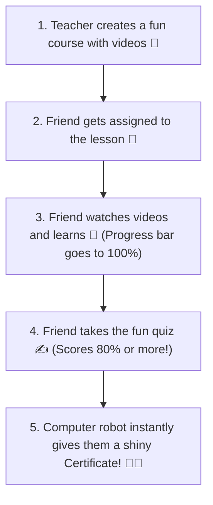

# The CollabCRM Training School (Explained Super Simple!) 🎈

Imagine a big, fun school where grown-ups go to learn new games, watch videos, and win shiny gold stars. That is what our **Training Module** is! 

Here is how the whole toy box works:

---

## 🚪 The 6 Magic Rooms (The Left Menu)

### 1. 📊 The Big Scoreboard (Dashboard)
This is a giant colorful wall with bright lights!
- It counts how many games we have (`Total Programmes`).
- It counts how many friends are playing right now (`Active Enrollments`).
- It shows if anyone forgot their homework (`Overdue`).
- It shows smiley charts of which team is learning the fastest!

---

### 2. 📚 The Book Shelf & Toy Builder (Training Management)
This is where the teacher creates fun lessons!
- **The Book Shelf**: A big table showing all our courses (like *Recruitment*, *Engineering*, or *Security*).
- **The Toy Builder (`+ Create Programme`)**:
  - The teacher types the lesson name (e.g. *How to use CollabCRM*).
  - The teacher drops in fun YouTube videos, picture books, and PDF playbooks.
  - The teacher creates a mini-quiz at the end with questions and answers.

---

### 3. 📝 The Homework List (Assignments)
This is the big chart that says who gets which lesson!
- It shows: **Friend's Name** ➡️ **Which Lesson They Got** ➡️ **When They Need To Finish**.
- It has a little eye button 👁️: tap it to peek inside and see everything about that friend's homework.

---

### 4. 📈 The Growing Plant (Training Progress)
This room lets you watch how tall everyone's progress plant has grown!
It has a magic two-way switch:
- **Friend View (Employee-wise)**: Look at each friend one-by-one. See their colored bar grow from **0%** ➡️ **50%** ➡️ **100%**!
- **Lesson View (Programme-wise)**: Look at the 12 lessons. See how many friends completed each lesson and tap to see who is inside!

---

### 5. 🏅 The Shiny Medal Wall (Certificates)
This is everyone's favorite room!
- When a friend finishes their lesson and scores **80% or higher** on the quiz... **POOF!** 🪄
- The computer robot immediately prints a beautiful gold certificate with their name on it!
- Nobody has to wait in line or ask a manager for permission. It happens like magic!

---

### 6. 📑 The Principal's Report (Reports)
A clean room where the big bosses can download neat charts and lists to see which team won the learning trophy this month.

---

## 🎒 What's Inside Every Friend's Backpack? (Employee Profile)

When you open any friend's personal page, they have two new pockets:
1. 📖 **Training History**: A diary of all lessons they ever started, what score they got, and whether they finished.
2. 🏆 **My Certificates**: A trophy shelf where they can download and print their shiny PDF certificates to hang on the wall!

---

## ⚙️ The Magic Clock & Rulebook (Config)

Behind the scenes, the teacher sets 3 simple rules:
1. **How many days to play:** Usually 14 days before homework is due.
2. **The winning score:** Usually 80% to earn the gold medal.
3. **Automated Magic:** Turn ON so certificates are handed out instantly without human waiting!

---

## 🌟 The 5-Step Magic Story (How it Works from Start to Finish)

